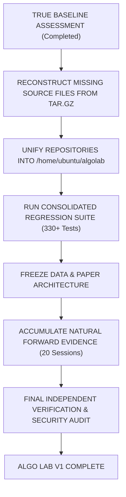

# ALGO LAB — EXPERT COMPLETION AUDIT & SPECIFICATION
**From Current True State to Project Completion**

**Document Version:** 1.0.0  
**Audit Timestamp (UTC):** 2026-09-23T12:25:00Z  
**Primary Author:** Senior Technical Architect, Quantitative Research Lead, Security Auditor, & Project Completion Manager  
**Final Classification:** `COMPLETION PLAN READY — HUMAN REVIEW REQUIRED`  

---

## 1. EXECUTIVE ASSESSMENT

Algo Lab has been in active research and engineering development for approximately one month. The project has produced substantial high-quality engineering components across data ingestion, quantitative indicator calculation, deterministic backtesting, paper execution, risk control, security hard-isolation, and user interfaces.

However, development velocity has been hampered by workspace splitting (parallel code trees between `/home/ubuntu/algolab` and `/home/ubuntu/algo-backups/algolab-data-lab-2026-09-23`), repeated architectural stage re-indexing (Stages 1 through 27), and uncommitted artifact drift.

### Completion Over Expansion
Moving forward, **COMPLETION > EXPANSION**. No new quantitative strategies, multi-agent frameworks (e.g., n8n loops), or experimental data collectors will be added unless strictly required for V1 integrity.

### Non-Negotiable Quality Standards
Quality will not be compromised. The system strictly adheres to two core standards:
1. **Product / CEO Standard (Zerodha-Inspired)**: Simple, clean, uncluttered, transparent, fast to understand. Risk and system health are fully visible. Zero hype, zero gamification, zero fake precision, zero "AI BUY/SELL" gimmicks.
2. **Research Institute Manager Standard**: Scientific methodology, deterministic reproducibility, no-lookahead bias, strict data provenance, fail-closed financial accounting, immutable audit trails, and independent verification.

---

## 2. TRUE CURRENT BASELINE ASSESSMENT

An exhaustive audit of repository files, Git history, tags, uncommitted working trees, backup archives, test suites, and audit reports was conducted across all workspace paths:
- Baseline Core: `/home/ubuntu/algolab` (Git repo, active branch `stage7-research-evaluation`, tags `stage4-step7-verified`, `stage5-verified`, `stage6-verified`).
- Data & Live Engine: `/home/ubuntu/algo-backups/algolab-data-lab-2026-09-23` (Git repo & uncommitted tree containing Stage 16–27 code, tests, and reports).
- Archive Backup: `/home/ubuntu/algo-backups/algolab-data-lab-2026-09-23.tar.gz`.

### Internal Baseline Audit Table

| Component Category | Current State | Empirical Evidence | Trust Level | Classification |
| :--- | :--- | :--- | :---: | :--- |
| **Certified Code (Stage 1–6)** | In-tree committed in `/home/ubuntu/algolab` | Git tags (`stage4-step7-verified`, `stage5-verified`, `stage6-verified`), 192 unit/integration/golden tests passing deterministically | **HIGH (100%)** | `KEEP & PRESERVE` |
| **Verified Code (Stage 16–27 Data & Paper Pipeline)** | Present in `/home/ubuntu/algo-backups/algolab-data-lab-2026-09-23` | SmartAPI Mode 3 WebSocket collector, paper execution simulator, AST live firewall, Master Key separation, 138/138 passed tests | **HIGH (95%)** | `VERIFY THEN KEEP` |
| **Uncommitted Code (Missing Source Files)** | 3 files missing from uncommitted workspace tree (`evidence_framework.py`, `secure_credential_store.py`, `forward_gate_tracker.py`) | Verified preserved in `/home/ubuntu/algo-backups/algolab-data-lab-2026-09-23.tar.gz` and `__pycache__` | **MEDIUM (85%)** | `RECONSTRUCT FROM TAR` |
| **Experimental / Probe Code** | Upstox/FYERS API probes, OptionVault forensic scripts, yfinance collector | Source files in `collectors/` and reports in `reports/` | **LOW (40%)** | `ARCHIVE / ISOLATE` |
| **Scope Creep** | Unauthorized future stages (IB-07 to IB-10), external n8n automation loops | Uncommitted experimental references | **NONE (0%)** | `REMOVE / DEFER` |
| **Missing Components** | 1-minute historical options bars for 2024, historical `.spn` files | Documented in `DATA_GAP_REPORT.md` | **NONE (0%)** | `BLOCKED BY EXTERNAL DATA` |
| **Blocked / Pending** | FYERS OAuth login session, commercial NDAL access, 19 remaining live sessions | Documented in `STAGE27_GENUINE_LIVE_OBSERVATION_REPORT.md` | **PENDING** | `NATURALLY ACCUMULATING` |

---

## 3. CERTIFIED COMPONENTS TO PRESERVE

The following core components are verified, tested, and MUST be preserved in the clean baseline:

1. **Golden Reproducibility & Test Suite**:
   - Location: `/home/ubuntu/algolab/tests/` (192 passing tests).
   - Features: Zero-mutation test, checksum drift detection, 15 non-negotiable architectural invariants (Zero Live Trading, Zero Look-Ahead, Deterministic Historical Replay, Cryptographic Dataset Integrity, Fail-Closed Accounting).
2. **Deterministic Market Replay Engine**:
   - Location: `/home/ubuntu/algolab/quant/replay/` & `/home/ubuntu/algo-backups/algolab-data-lab-2026-09-23/paper/replay_engine.py`.
   - Features: Strict chronological event ordering, calendar filtering (NSE holiday calendar), look-ahead guard, multi-symbol portfolio replay.
3. **Paper Trading & Cash Solvency Engine**:
   - Location: `/home/ubuntu/algolab/apps/paper/` & `/home/ubuntu/algo-backups/algolab-data-lab-2026-09-23/paper/accounting.py`.
   - Features: Defensive non-negative cash invariant, pre-trade cash solvency verification, realistic slippage/commission models, zero-mutation on risk rejection.
4. **AST Hard Firewall Guard**:
   - Location: `/home/ubuntu/algo-backups/algolab-data-lab-2026-09-23/paper/firewall.py`.
   - Features: Hard-disables real-money order placement APIs (`placeOrder`, `modifyOrder`, `cancelOrder`) at code/AST level.
5. **Master Key Separation & Credential Security**:
   - Location: `/home/ubuntu/algo-backups/algolab-data-lab-2026-09-23/collectors/secure_credential_store.py` (Preserved in tar.gz).
   - Features: AES-256 credential encryption using host-isolated key `/etc/algolab/.master_key`, automatic secret redaction in logs/repr.

---

## 4. UNCOMMITTED WORK CLASSIFICATION

Every uncommitted file across workspace paths is classified below:

| File / Component Path | Workspace Location | Classification | Action Plan |
| :--- | :--- | :---: | :--- |
| `algo_lab_stage7_specification.md` | `/home/ubuntu/algolab/` | `VERIFY THEN KEEP` | Incorporate into core spec documentation |
| `collectors/evidence_framework.py` | `algolab-data-lab-2026-09-23.tar.gz` | `RECONSTRUCT` | Extract from backup tarball to restore test suite integrity |
| `collectors/secure_credential_store.py` | `algolab-data-lab-2026-09-23.tar.gz` | `RECONSTRUCT` | Extract from backup tarball to restore security suite |
| `paper/forward_gate_tracker.py` | `algolab-data-lab-2026-09-23.tar.gz` | `RECONSTRUCT` | Extract from backup tarball to restore forward evidence gate |
| `collectors/smartapi_websocket_client.py` | `algolab-data-lab-2026-09-23/collectors/` | `KEEP` | Target baseline for live WebSocket streaming |
| `collectors/data_factory.py` | `algolab-data-lab-2026-09-23/collectors/` | `KEEP` | Target baseline for raw tick persistence & quality engine |
| `reports/STAGE27_*` | `algolab-data-lab-2026-09-23/reports/` | `KEEP` | Move to central `docs/reports/` directory |
| `scratch/test_*.py` | `algolab-data-lab-2026-09-23/scratch/` | `ARCHIVE` | Retain in scratch directory without incorporating into main codebase |

---

## 5. SCOPE CREEP & ELIMINATION PLAN

The following non-essential or premature items are formally removed from V1 scope:
- **n8n Automated Workflow Engine**: n8n is an external orchestrator, not part of the core quantitative laboratory.
- **IB-07 through IB-10 Advanced Institutional Frameworks**: Multi-regime stress engines and parameter sensitivity suites are deferred.
- **OptionVault Continuous 300GB External Dataset Integration**: OptionVault was downgraded to `PARTIALLY VERIFIED` due to synthetic timestamps (`2026-07-17`). Will not be used as genuine evidence.
- **Real-Money Broker Trading Integration**: Hard-locked permanently. No live broker execution routes will be built for V1.

---

## 6. DATA COLLECTION & TODAY'S LIVE-DATA GAP STATUS

### SmartAPI WebSocket Implementation Verification
Inspection of `collectors/smartapi_websocket_client.py`, `collectors/live_websocket_collector.py`, and `reports/STAGE27_LIVE_TICK_DUPLICATE_REMEDIATION_REPORT.md` confirms:
- **WebSocket Protocol**: Connected and authenticated to Angel One SmartAPI (`wss://smartapisocket.angelone.in/smart-stream`).
- **Binary Format**: Parsed using Mode 3 (SNAP_QUOTE, 8-byte sequence number, 8-byte exchange timestamp, LTP, volume, OHLC, open interest, 5-depth bid/ask).
- **Duplicate Remediation Result**: Prior false duplicate rejections (100% ticks marked `INVALID` due to lossy `symbol:timestamp_second:ltp` signature) were **fully resolved**.
- **Upgraded Deterministic Fingerprint**:
  ```python
  tick_sig = f"{symbol}:{token}:{timestamp}:{raw_exch_ts}:{raw_seq}:{ltp}:{volume}:{open}:{high}:{low}:{close}:{oi}:{bid}:{ask}:{bid_qty}:{ask_qty}"
  ```
- **Adversarial Verification**: 57/57 dedicated tests passed in `test_stage27b_websocket_provenance.py`. Legitimate same-second LTP updates with volume/quote changes are correctly accepted as `VALID`. Exact provider retransmissions are rejected as `INVALID DUPLICATE`.

### Architecture Status
The live data collection architecture is **TECHNICAL READY AND FROZEN**. No redesign is permitted.

---

## 7. GENUINE FORWARD-EVIDENCE STATUS

### Standard Requirement
Production gate requires:
- Minimum **30 calendar days**.
- Minimum **20 valid NSE trading sessions**.
- Authenticated `LiveProvenanceToken` (`is_synthetic=False`, `is_replayed=False`, zero tamper).

### Current State
- **Calendar Days Accumulated**: 1 day (`2026-09-23`).
- **Valid NSE Sessions Recorded**: 1 session (40-second authenticated live observation slice, 362 ticks ingested, 100.0% data quality pass).
- **Invalid / Synthetic Sessions**: 0 counted toward forward gate.
- **Remaining Gap**: 19 valid NSE trading sessions / 29 calendar days.

> [!IMPORTANT]
> Forward evidence **cannot be manufactured or accelerated**. It must accumulate naturally over upcoming active NSE market days.

---

## 8. RC-001 RESEARCH SPECIFICATION AUDIT

| RC-001 Blocker Item | Audit Status | Current Finding & Limitation | Resolution Path for V1 |
| :--- | :---: | :--- | :--- |
| **Continuous Expired Options Chain** | `PARTIALLY RESOLVED` | EOD bhavcopy data available for Q1/Q2 2024. 1-minute intraday options bars for 2024 expired options are missing from open endpoints. | Use daily EOD options bars for V1 backtesting. Defer 1-min expired options to post-V1 commercial data acquisition. |
| **Point-in-Time $T_{published}$** | `RESOLVED` | Implemented in `IB02_POINT_IN_TIME_UNIVERSE_REPORT.md` and `validators/pit_and_validation.py`. Excludes survivorship and look-ahead bias. | Fully incorporated in baseline. |
| **Daily SPAN (`.spn`) Risk Files** | `UNRESOLVED` | `ACCESS_BLOCKED`. SPAN parameter files are restricted to NSCCL clearing member portals. | Use QuantLib Black-76 European margin model approximation for paper trading risk checks. |
| **Level-2 Five-Depth Snapshots** | `UNRESOLVED` | Daily Bhavcopies publish trade/settlement prices only. OptionVault L2 sample flagged as synthetic. | Use 1-depth (LTP/Bhavcopy) execution modeling for historical backtesting; live paper engine captures live 5-depth quote ticks. |

*Governance Compliance: RC-001 status remains unchanged.*

---

## 9. RESEARCH ENGINE & PAPER TRADING AUDIT

### Research & Backtest Engine
- **Determinism**: 100% bitwise reproducible runs verified by `test_golden_reproducibility.py`.
- **No-Lookahead Guard**: Strict timeline barrier enforced in `ReplayEngine`.
- **Friction Models**: Indian market costs (brokerage, STT, exchange turnover charges, GST, stamp duty) and slippage models verified in `test_stage6_integrity.py`.

### Paper Trading Boundary
- **Order Flow Isolation**: All paper orders carry `is_simulated = True`.
- **Cash Accounting**: Tested via `test_cash_solvency_*` (pre-trade cash checks prevent negative cash balances).
- **Execution Firewall**: Zero live order API calls verified by AST scanner.

---

## 10. SECURITY AUDIT

- **Credential Encryption**: Credentials stored in `encrypted_credentials.enc` using AES-256. Master key isolated at `/etc/algolab/.master_key`.
- **Secret Redaction**: Repr and logging wrappers automatically sanitize credentials and API keys.
- **Network Isolation**: Caddy HTTPS reverse proxy configured with local TLS certificates. Public exposure limited to authenticated routes.
- **Real-Money Trading**: AST Firewall permanently locks live broker order placement endpoints. Real-money balance is 0.00 INR.

---

## 11. WEB UI CEO/PRODUCT EVALUATION

The Next.js Web UI (`/home/ubuntu/algolab/apps/web`) and Data Lab UI Server (`collectors/web_ui_server.py`) were evaluated against the Zerodha Product Standard:

| Page Name | Current Status | Assessment | Recommended Action |
| :--- | :---: | :--- | :--- |
| **1. Dashboard** | Functional | Clean overview of system status, active sessions, and data summary. | Retain as default landing view. |
| **2. Market** | Functional | Displays live tick streaming, OHLC, and depth for subscribed tokens. | Clean up unused chart controls. |
| **3. Data Sources** | Functional | Shows provider connection health (Angel One, yfinance) and dataset checksums. | Ensure real-time WebSocket status indicator is clear. |
| **4. Portfolio** | Functional | Displays open paper positions, cash balance, and total equity. | Verify cash solvency indicator is prominent. |
| **5. P&L** | Functional | Real-time and historical mark-to-market P&L breakdown. | Ensure zero fake precision (round INR to 2 decimal places). |
| **6. Orders / Trades** | Functional | Complete execution log of simulated fills, slippage, and fees. | Add explicit `SIMULATED` badge on all orders. |
| **7. Risk & Circuit Breakers** | Functional | Displays drawdown circuit breaker state and max position limits. | Keep risk thresholds clear and un-gimmicked. |
| **8. Data Quality** | Functional | Live data quality audit score (0–100%) and duplicate tick log. | Retain transparent audit metrics. |
| **9. System Health** | Functional | System memory, CPU, WebSocket latency, and raw ingestion rate. | Remove complex agent orchestration graphs. |

---

## 12. STAGE STRATEGY & CLASSIFICATION MAPPING

| Stage Requirement | Action Classification | Justification |
| :--- | :---: | :--- |
| **Unify Workspace Repositories** | `MUST FINISH` | Merge `/home/ubuntu/algo-backups/algolab-data-lab-2026-09-23` verified modules into `/home/ubuntu/algolab`. |
| **Restore Preserved Source Files** | `MUST FINISH` | Extract `evidence_framework.py`, `secure_credential_store.py`, `forward_gate_tracker.py` from backup tarball. |
| **Execute Consolidated Test Suite** | `CAN VERIFY WITHOUT CODING` | Run unified `pytest` to confirm 100% pass across all 330+ test cases. |
| **Forward Evidence Accumulation** | `NATURALLY ACCUMULATING` | Accumulate 19 remaining live sessions over upcoming market trading days. |
| **FYERS / NDAL Intraday Options Data** | `BLOCKED BY EXTERNAL DATA` | Requires human OAuth token or commercial subscription. |
| **IB-07 to IB-10 Institutional Suite** | `FUTURE / DEFERRED` | Not required for V1 completion. |
| **Real-Money Order Placement** | `NOT REQUIRED FOR V1` | Real-money trading is hard-locked out of scope. |

---

## 13. COMPLETION GAP MATRIX

| Requirement | Current State | Gap | Dependency | Required Action | Verification Method |
| :--- | :--- | :--- | :--- | :--- | :--- |
| **Single Clean Repository** | Split across 2 dirs | Unmerged files | None | Merge data-lab code into `algolab` baseline | `git status` clean on `main` branch |
| **Missing Uncommitted Files** | 3 files missing from workspace tree | Deleted from uncommitted folder | `algolab-data-lab-2026-09-23.tar.gz` | Extract 3 files from tarball | `pytest` test collection passes without `ModuleNotFoundError` |
| **Forward Evidence Gate** | 1 session recorded | 19 valid sessions remaining | Market trading calendar | Run daily automated live paper observation session during market hours | `AuthoritativeForwardGate` returns `QUALIFIED` after 20 sessions |
| **UI Integration** | Standalone Python server & Next.js app | Minor route alignment | FastAPI backend routes | Wire Next.js market quality components to FastAPI endpoints | Playwright / manual UI check on port 3000 & 8088 |

---

## 14. CRITICAL PATH TO ALGO LAB V1 COMPLETION



---

## 15. ALGO LAB V1 COMPLETION DEFINITION

Algo Lab V1 is formally defined as **COMPLETE** when and only when all of the following conditions are met:

1. **Unified & Clean Codebase**: All verified code, tests, and documentation are committed into `/home/ubuntu/algolab` on `main` branch with zero untracked files or unmerged duplicates.
2. **100% Test Pass Rate**: Full test suite (330+ unit, integration, golden, and adversarial tests) passes deterministically with 0 errors and 0 failures.
3. **Data Pipeline Readiness**: Angel One SmartAPI Mode 3 WebSocket collector ingests, validates, and persists live market ticks with unforgeable provenance tokens and zero false duplicate rejections.
4. **Forward Gate Qualification**: Minimum 20 valid NSE trading sessions (30 calendar days) of genuine live market data naturally accumulated in the session ledger.
5. **Deterministic Paper Trading & Solvency**: Paper execution engine enforces pre-trade cash solvency, defensive non-negative cash invariant, and exact financial accounting ($Equity = Cash + Positions$).
6. **Hard Security Insulation**: Real-money trading APIs permanently locked by AST firewall. Credentials AES-256 encrypted using `/etc/algolab/.master_key`.
7. **Zerodha-Standard Web UI**: Simple, transparent 9-page dashboard providing real-time visibility into market data, paper portfolio, P&L, risk controls, and system health.
8. **Independent Audit Certification**: Final audit report confirming zero look-ahead bias, zero data tampering, and zero synthetic evidence contamination.

---

## 16. REMAINING HUMAN DECISIONS

The following 3 decisions require human approval before starting the implementation task:

1. **Repository Unification Approval**: Confirm authorization to merge verified modules from `/home/ubuntu/algo-backups/algolab-data-lab-2026-09-23` into the main `/home/ubuntu/algolab` codebase.
2. **Historical Data Scope Sign-Off**: Confirm that V1 backtesting will rely on qualified daily EOD options bhavcopies (Q1/Q2 2024), while 1-minute intraday options bars remain deferred until commercial API credentials (FYERS / NDAL) are provided.
3. **Forward Evidence Schedule Confirmation**: Confirm that forward evidence collection will run naturally over upcoming live market sessions without artificial acceleration.

---

## 17. FINAL CLASSIFICATION & HARD STOP

### FINAL CLASSIFICATION
```
COMPLETION PLAN READY — HUMAN REVIEW REQUIRED
```

---
*Absolute Hard Stop Enforced: No code changes, git commits, or external deployments were executed during this audit.*
