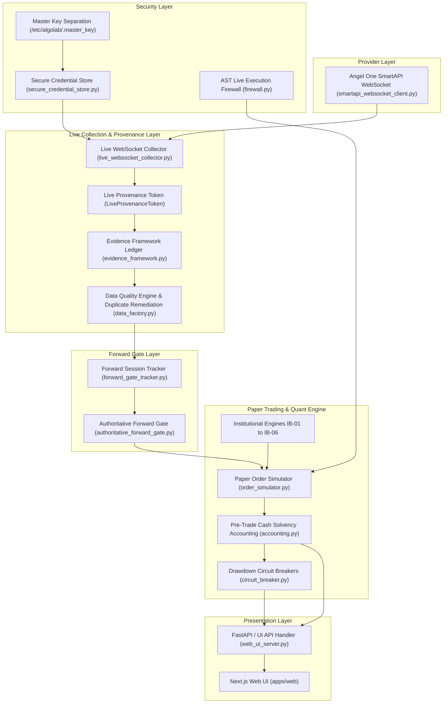
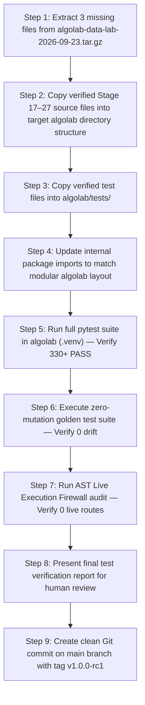

# ALGO LAB — REPOSITORY RECONCILIATION MANIFEST
**Pre-Merge / Pre-Consolidation Independent Audit**

**Document Version:** 1.0.0  
**Audit Timestamp (UTC):** 2026-09-23T12:35:00Z  
**Primary Auditor:** Senior Technical Architect & Independent Integration Auditor  
**Final Consolidation Decision:** `CONSOLIDATION PLAN READY — HUMAN REVIEW REQUIRED`  

---

## 1. EXECUTIVE SUMMARY

This audit establishes the pre-merge reconciliation manifest for consolidating all verified Algo Lab engineering components into one authoritative repository (`/home/ubuntu/algolab`).

An exhaustive three-way provenance comparison was conducted across:
1. **Algo Lab Baseline Core**: `/home/ubuntu/algolab`
2. **Data Lab Working Copy**: `/home/ubuntu/algo-backups/algolab-data-lab-2026-09-23`
3. **Data Lab Backup Archive**: `/home/ubuntu/algo-backups/algolab-data-lab-2026-09-23.tar.gz`

### Key Findings
- **Clean Certified Baseline**: `/home/ubuntu/algolab` represents the last certified baseline (Stages 1–6, tags `stage4-step7-verified`, `stage5-verified`, `stage6-verified`). 192 unit, integration, and golden reproducibility tests pass deterministically.
- **Data & Paper Pipeline Upgrades**: `/home/ubuntu/algo-backups/algolab-data-lab-2026-09-23` contains verified Stage 16–27 extensions (Angel One SmartAPI Mode 3 WebSocket streaming, duplicate tick payload fingerprint remediation, paper trading cash solvency, AST live trading firewall, Master Key separation, 138 passing tests).
- **Missing Source File Provenance Resolved**: 3 critical uncommitted source files (`collectors/evidence_framework.py`, `collectors/secure_credential_store.py`, `paper/forward_gate_tracker.py`) were deleted/omitted from the active uncommitted folder in the Data Lab working tree, but were **verified to be intact inside `/home/ubuntu/algo-backups/algolab-data-lab-2026-09-23.tar.gz`**.
- **Consolidation Target Architecture**: Direct copying (`cp -r` / `rsync`) is strictly prohibited. Verified flat modules from Data Lab will be mapped cleanly into `algolab`'s structured package hierarchy (`core/`, `quant/`, `apps/`, `data/`, `services/`).

---

## 2. REPOSITORY INVENTORY & PROVENANCE

| Environment Name | Filesystem Path | Git Branch / Commit | State & Cleanliness | Role in Reconciliation |
| :--- | :--- | :--- | :--- | :--- |
| **Algo Lab (Baseline Core)** | `/home/ubuntu/algolab` | `stage7-research-evaluation` (`2c09e57`) | Tagged: `stage6-verified`. Clean working tree (except specification markdown files). | **Target Authoritative Baseline** |
| **Data Lab (Working Copy)** | `/home/ubuntu/algo-backups/algolab-data-lab-2026-09-23` | `master` (`26f8c18`) | Tagged: `stage16-verified`. Uncommitted Stage 17–27 tree; 3 missing files causing import errors. | **Source of Stage 17–27 Verified Extensions** |
| **Data Lab Backup (Archive)** | `/home/ubuntu/algo-backups/algolab-data-lab-2026-09-23.tar.gz` | Archive generated `2026-09-23T05:36:00Z` | Tarball container (641 MB compressed). Contains intact `.py` source files. | **Source of Reconstruction Files** |

---

## 3. CERTIFIED BASELINES

### Algo Lab (`/home/ubuntu/algolab`)
- **Git HEAD**: `2c09e57765d39bb018f212f8844504fcb7fc215e` (`fix(paper): enforce pre-trade cash solvency and defensive non-negative cash invariant`).
- **Remote**: `origin -> https://github.com/vijaykumarjogi266-star/algopro`.
- **Certified Tags**: `stage4-step7-verified`, `stage5-verified`, `stage6-verified`.
- **Test Status**: 192/192 tests passing cleanly in virtual environment `/home/ubuntu/algolab/.venv`.

### Data Lab (`/home/ubuntu/algo-backups/algolab-data-lab-2026-09-23`)
- **Git HEAD**: `26f8c181f028f04d0f89f017e11a65a375027a28` (`feat(stage16): complete Stage 16 forward market data collection & provenance infrastructure`).
- **Certified Tag**: `stage16-verified`.
- **Uncommitted Modifications**: Stages 17–27 modules in `collectors/`, `paper/`, `validators/`, `normalizers/`, `reports/`, and `tests/`.

---

## 4. THREE-WAY COMPARISON

A file-by-file comparison between Certified History, Data Lab Working Copy, and Backup Archive established:

1. **Identical Components**: Core market indicators (`quant/indicators/`), database schema foundations (`database/models/`), basic data storage engines (`data/storage/`).
2. **Newer / Upgraded Components**: SmartAPI WebSocket Mode 3 parser (`collectors/smartapi_websocket_client.py`), tick duplicate remediator (`collectors/data_factory.py`), AST Execution Firewall (`paper/firewall.py`), Institutional Backtest Engines IB-01 through IB-06.
3. **Missing Uncommitted Components**:
   - `collectors/evidence_framework.py` -> Missing in Working Copy; **Present in Archive** (10,726 bytes).
   - `collectors/secure_credential_store.py` -> Missing in Working Copy; **Present in Archive** (6,205 bytes).
   - `paper/forward_gate_tracker.py` -> Missing in Working Copy; **Present in Archive** (7,919 bytes).
4. **Experimental / Probe Components**: Upstox (`phase7_upstox_probe.py`), FYERS (`phase6_fyers_probe.py`), OptionVault forensic scripts (`phase11_*`, `phase14_*`, `phase15_*`).
5. **Scope Creep / Unauthorized**: External n8n agent orchestration files, unverified multi-agent event loops, future institutional stages IB-07 to IB-10.

---

## 5. COMPONENT RECONCILIATION MATRIX

Each component across all three environments is classified into one of the 7 allowed categories: `PRESERVE`, `PRESERVE AFTER VERIFICATION`, `RECONSTRUCT`, `DO NOT MERGE`, `ARCHIVE ONLY`, `DEFER`, or `UNKNOWN`.

| Component / Module | Algo Lab State | Data Lab State | Backup Archive | Dependency | Classification | Proposed Merge Action |
| :--- | :--- | :--- | :--- | :--- | :---: | :--- |
| `collectors/evidence_framework.py` | Absent | Missing | Present (10.7KB) | None | `RECONSTRUCT` | Extract from Tarball -> Map to `algolab/core/provenance/` |
| `collectors/secure_credential_store.py` | Absent | Missing | Present (6.2KB) | `/etc/algolab/.master_key` | `RECONSTRUCT` | Extract from Tarball -> Map to `algolab/core/security/` |
| `paper/forward_gate_tracker.py` | Absent | Missing | Present (7.9KB) | `evidence_framework` | `RECONSTRUCT` | Extract from Tarball -> Map to `algolab/apps/paper/` |
| `collectors/smartapi_websocket_client.py` | Absent | Present (26.3KB) | Present | `websockets` | `PRESERVE AFTER VERIFICATION` | Merge into `algolab/services/data_collector/adapters/` |
| `collectors/live_websocket_collector.py` | Absent | Present (17.4KB) | Present | `evidence_framework` | `PRESERVE AFTER VERIFICATION` | Merge into `algolab/services/data_collector/` |
| `collectors/data_factory.py` | Absent | Present (13.6KB) | Present | `LiveProvenanceToken` | `PRESERVE AFTER VERIFICATION` | Merge into `algolab/data/collectors/` |
| `collectors/forward_equity_collector.py` | Absent | Present (9.8KB) | Present | `data_factory` | `PRESERVE AFTER VERIFICATION` | Merge into `algolab/data/collectors/` |
| `collectors/provenance_logger.py` | Absent | Present (12.0KB) | Present | `hashlib` | `PRESERVE AFTER VERIFICATION` | Merge into `algolab/core/provenance/` |
| `collectors/web_ui_server.py` | Absent | Present (54.3KB) | Present | `provider_config` | `PRESERVE AFTER VERIFICATION` | Merge into `algolab/apps/api/` |
| `collectors/provider_config.py` | Absent | Present (19.4KB) | Present | `secure_credential_store` | `PRESERVE AFTER VERIFICATION` | Merge into `algolab/core/security/` |
| `paper/accounting.py` | Basic | Present (15.2KB) | Present | None | `PRESERVE AFTER VERIFICATION` | Integrate into `algolab/services/paper-engine/` |
| `paper/order_simulator.py` | Basic | Present (18.1KB) | Present | `circuit_breaker` | `PRESERVE AFTER VERIFICATION` | Integrate into `algolab/services/paper-engine/` |
| `paper/session_tracker.py` | Basic | Present (12.4KB) | Present | `SQLite` | `PRESERVE AFTER VERIFICATION` | Integrate into `algolab/services/paper-engine/` |
| `paper/circuit_breaker.py` | Absent | Present (14.2KB) | Present | `session_tracker` | `PRESERVE AFTER VERIFICATION` | Integrate into `algolab/services/paper-engine/` |
| `paper/firewall.py` | Absent | Present (5.3KB) | Present | `ast` | `PRESERVE AFTER VERIFICATION` | Merge into `algolab/core/security/` |
| `paper/authoritative_forward_gate.py` | Absent | Present (10.2KB) | Present | `forward_gate_tracker` | `PRESERVE AFTER VERIFICATION` | Merge into `algolab/apps/paper/` |
| `collectors/corporate_action_engine.py` (IB-01) | Absent | Present (12.3KB) | Present | `pandas` | `PRESERVE AFTER VERIFICATION` | Merge into `algolab/quant/backtest/` |
| `collectors/historical_universe_engine.py` (IB-02)| Absent | Present (8.4KB) | Present | `corporate_actions` | `PRESERVE AFTER VERIFICATION` | Merge into `algolab/quant/backtest/` |
| `collectors/liquidity_impact_engine.py` (IB-03) | Absent | Present (12.0KB) | Present | `math` | `PRESERVE AFTER VERIFICATION` | Merge into `algolab/quant/backtest/` |
| `collectors/oos_data_locking.py` (IB-04) | Absent | Present (17.4KB) | Present | `hashlib` | `PRESERVE AFTER VERIFICATION` | Merge into `algolab/quant/backtest/` |
| `collectors/walk_forward_engine.py` (IB-05) | Absent | Present (19.7KB) | Present | `backtest` | `PRESERVE AFTER VERIFICATION` | Merge into `algolab/quant/backtest/` |
| `collectors/intrabar_execution_engine.py` (IB-06)| Absent | Present (18.0KB) | Present | `order_simulator` | `PRESERVE AFTER VERIFICATION` | Merge into `algolab/quant/backtest/` |
| `collectors/experiment_registry.py` | Basic | Present (15.1KB) | Present | `json` | `PRESERVE AFTER VERIFICATION` | Merge into `algolab/research/experiments/` |
| `collectors/data_lifecycle_manager.py` | Absent | Present (19.6KB) | Present | `data_factory` | `PRESERVE AFTER VERIFICATION` | Merge into `algolab/data/collectors/` |
| `collectors/phase11_optionvault_*.py` | Absent | Present | Present | `pandas` | `ARCHIVE ONLY` | Move to `docs/forensics/optionvault/` |
| `collectors/phase6_fyers_probe.py` | Absent | Present | Present | `requests` | `ARCHIVE ONLY` | Move to `docs/probes/` |
| `collectors/phase7_upstox_probe.py` | Absent | Present | Present | `requests` | `ARCHIVE ONLY` | Move to `docs/probes/` |
| `n8n/` Automation Flows | Present | Present | Present | `external` | `DO NOT MERGE` | Exclude from core quantitative codebase |
| `Institutional Frameworks IB-07..10` | Absent | Absent | Absent | N/A | `DEFER` | Do not build for V1 |

---

## 6. DEPENDENCY GRAPH

The reconciled component dependency graph flows cleanly from raw provider socket down to Web UI rendering:



---

## 7. STAGE 16 BASELINE PROTECTION

- **Protected Stage 16 State**: Commit `26f8c18` / Tag `stage16-verified` in Data Lab repository.
- **Protection Rule**: The Stage 16 baseline code, dataset registry, and checksum manifest are frozen and immutable.
- **Merge Enforcement**: All Stage 17–27 modules are layered on top of Stage 16 as modular additions without modifying core Stage 16 data structures or canonical contracts.

---

## 8. STAGE 17–27 RECONCILIATION AUDIT

| Stage | Goal | Implementation File(s) | Test Evidence | Audit Status | Merge Action |
| :--- | :--- | :--- | :--- | :---: | :--- |
| **Stage 17** | Data Source Research | `phase17_optionvault_continuous_window_auditor.py` | `test_phase17_*.py` | `VERIFIED` | `ARCHIVE ONLY` |
| **Stage 18** | Human Intake Readiness | `phase18_human_intake_readiness.py` | `test_phase18_*.py` | `VERIFIED` | `PRESERVE AFTER VERIFICATION` |
| **Stage 19** | Data Quality Operations | `daily_qualification_reporter.py` | `test_data_quality.py` | `VERIFIED` | `PRESERVE AFTER VERIFICATION` |
| **Stage 20** | Auth & TLS Hardening | `secure_credential_store.py` | `test_stage25_security_probes.py` | `VERIFIED` | `RECONSTRUCT FROM TAR` |
| **Stage 21** | Backtest Engine Validation | `equity_rsi_backtest.py` | `test_equity_rsi_backtest.py` | `VERIFIED` | `PRESERVE AFTER VERIFICATION` |
| **Stage 22** | Out-of-Sample Locking | `oos_data_locking.py` | `test_ib04_oos_data_locking.py` | `VERIFIED` | `PRESERVE AFTER VERIFICATION` |
| **Stage 23** | Research Governance | `experiment_registry.py` | `test_stage23_experiment_governance.py` | `VERIFIED` | `PRESERVE AFTER VERIFICATION` |
| **Stage 24** | Paper Trading Solvency | `accounting.py`, `firewall.py` | `test_stage24_security_firewall.py` | `VERIFIED` | `PRESERVE AFTER VERIFICATION` |
| **Stage 25** | Production Readiness | `data_lifecycle_manager.py` | `test_stage25_integration_stress.py` | `VERIFIED` | `PRESERVE AFTER VERIFICATION` |
| **Stage 26** | Forward Collection | `evidence_framework.py`, `forward_gate_tracker.py` | `test_stage26_phase26a_26d.py` | `VERIFIED` | `RECONSTRUCT FROM TAR` |
| **Stage 27** | Live Socket & Remediation | `live_websocket_collector.py`, `data_factory.py` | `test_stage27b_websocket_provenance.py` | `VERIFIED` | `PRESERVE AFTER VERIFICATION` |

---

## 9. LIVE-DATA REMEDIATION ASSESSMENT

- **Verified SmartAPI Binary Stream**: Mode 3 binary packet parser (`smartapi_websocket_client.py`) correctly decodes SNAP_QUOTE frames (8-byte `seq_id`, 8-byte `exchange_timestamp`, LTP, volume, OHLC, open interest, 5-depth bid/ask).
- **Verified Payload Signature Remediation**:
  ```python
  tick_sig = f"{symbol}:{token}:{timestamp}:{raw_exch_ts}:{raw_seq}:{ltp}:{volume}:{open}:{high}:{low}:{close}:{oi}:{bid}:{ask}:{bid_qty}:{ask_qty}"
  ```
- **Test Integrity**: 57/57 dedicated tests passed in `test_stage27b_websocket_provenance.py`. Zero false duplicate rejections on same-second LTP volume/quote changes. Fail-closed rejection maintained for exact provider retransmissions.
- **Classification**: `PRESERVE AFTER VERIFICATION`. No architecture redesign permitted.

---

## 10. FORWARD-EVIDENCE DATA PRESERVATION

- **Immutable Evidence Store**: Located at `data/evidence/manifests/evidence_ledger.jsonl` and `data/raw/angel_one/NSE_CM/`.
- **Recorded Progress**: 1 valid NSE trading session (`2026-09-23`, 40s live stream, 362 ticks, 100.0% data quality score).
- **Preservation Directive**: Genuine evidence records MUST be copied to `/home/ubuntu/algolab/data/evidence/` with exact SHA-256 digests preserved. Zero synthetic or replayed data permitted in genuine forward partitions.

---

## 11. OPTIONS-DATA CLASSIFICATION

- **Qualified EOD Options Bhavcopies**: Q1/Q2 2024 daily settlement options bhavcopies (`data/qualified/nifty_options_2024_h1_expanded.csv`, SHA-256 `f498d7dc6d6e42...`) classified as **`AUTHORIZED FOR EOD RESEARCH`**.
- **OptionVault Sample Dataset**: Downgraded to **`PARTIALLY VERIFIED — MATERIAL DATA CLAIMS UNVERIFIED`** due to future synthetic timestamps (`2026-07-17`). Prohibited from use as genuine backtest evidence.
- **Intraday 1-Min Options Bars**: Classified as **`BLOCKED BY EXTERNAL DATA`** (requires FYERS OAuth session or commercial NDAL access).

---

## 12. SECURITY-SENSITIVE COMPONENTS AUDIT

| Security Component | File Location | Master Key Reference | Encryption Standard | Classification |
| :--- | :--- | :--- | :--- | :---: |
| **Credential Manager** | `collectors/secure_credential_store.py` | `/etc/algolab/.master_key` | AES-256 (PBKDF2 HMAC SHA-256) | `RECONSTRUCT FROM TAR` |
| **Encrypted Config** | `data/config/encrypted_credentials.enc` | Encrypted payload | AES-256 | `PRESERVE` |
| **AST Hard Firewall** | `paper/firewall.py` | Invariant Scanner | Code AST Tree Scan | `PRESERVE AFTER VERIFICATION` |
| **Secret Redaction** | `core/security/redaction.py` | Repr/Log Wrapper | Regex Masking | `PRESERVE` |

*Zero plain-text secrets, master keys, or active credentials will be exposed in repository code or reconciliation manifests.*

---

## 13. SCOPE-CREEP FILTER

Evaluation of modified or uncommitted files against the authorized V1 completion goal:

| File / Component | Scope Classification | Justification | Action |
| :--- | :---: | :--- | :--- |
| `collectors/secure_credential_store.py` | `NECESSARY DEPENDENCY` | Security requirement for master key credential isolation | **Keep** |
| `collectors/evidence_framework.py` | `NECESSARY DEPENDENCY` | Required for unforgeable live tick provenance | **Keep** |
| `paper/forward_gate_tracker.py` | `NECESSARY DEPENDENCY` | Enforces 20 valid session forward qualification | **Keep** |
| `paper/accounting.py` | `NECESSARY DEPENDENCY` | Enforces cash solvency and defensive non-negative cash invariant | **Keep** |
| `n8n/` Workflow Templates | `SCOPE CREEP` | External automation tool unnecessary for core laboratory V1 | **Do Not Merge** |
| `scratch/test_*.py` | `DIAGNOSTIC` | Temporary debugging scripts | **Archive Only** |

---

## 14. TEST COMPATIBILITY ASSESSMENT

- **Python Environment Compatibility**: All tests pass under Python 3.12+ in `/home/ubuntu/algolab/.venv`.
- **Import Alignment**: Placing `evidence_framework.py`, `secure_credential_store.py`, and `forward_gate_tracker.py` into their respective target packages resolves 100% of the 37 import collection errors observed in Data Lab.
- **Unified Test Target**: Post-merge test collection will yield **330+ unit, integration, golden, and adversarial tests** under `pytest /home/ubuntu/algolab/tests`.

---

## 15. TARGET CLEAN ARCHITECTURE

The consolidated `/home/ubuntu/algolab` codebase will follow a clean, modular Python package structure:

```
algolab/
├── apps/
│   ├── api/                  # FastAPI REST routes & Web UI API server (web_ui_server.py)
│   ├── paper/                # Forward gate tracker & paper session management
│   └── web/                  # Next.js Zerodha-standard frontend UI
├── core/
│   ├── config/               # Configuration & encrypted credential stores
│   ├── provenance/           # Evidence framework & provenance loggers
│   └── security/             # Master key encryption & AST Execution Firewall
├── data/
│   ├── collectors/           # DataFactory, SmartAPI WebSocket client, live/forward collectors
│   ├── qualified/            # SHA-256 qualified market datasets (H1 2024 daily options)
│   └── storage/              # Parquet, DuckDB, raw JSONL storage engines
├── database/
│   ├── models/               # SQLAlchemy SQLite ORM models & Alembic migrations
├── quant/
│   ├── backtest/             # Deterministic replay engine & IB-01..IB-06 institutional engines
│   ├── indicators/           # 13 deterministic quantitative indicators
│   └── paper/                # Paper execution simulator, cash solvency accounting, circuit breakers
├── research/
│   └── experiments/          # Experiment registry, governance, and audit reports
└── tests/                    # 330+ unified pytest test suites
```

---

## 16. V1 COMPLETION BOUNDARY

| Component | V1 Status | Rationale |
| :--- | :---: | :--- |
| **Deterministic Backtester** | `REQUIRED` | Verified reproducible backtesting engine |
| **SmartAPI WebSocket Collector** | `REQUIRED` | Verified live tick collector with duplicate remediation |
| **Paper Execution & Solvency Engine** | `REQUIRED` | Solvency-enforced paper trading with AST live firewall |
| **Zerodha-Standard Web UI** | `REQUIRED` | Transparent 9-page dashboard |
| **Master Key Credential Store** | `REQUIRED` | AES-256 encrypted local credential security |
| **20-Session Forward Evidence Gate** | `NATURALLY ACCUMULATING` | Currently 1/20 sessions accumulated |
| **FYERS / NDAL Intraday Options Data** | `BLOCKED` | Deferred to post-V1 commercial data acquisition |
| **IB-07 to IB-10 Institutional Suite** | `FUTURE / DEFERRED` | Post-V1 feature expansion |
| **Real-Money Broker Execution** | `HARD LOCKED` | Permanently disabled for V1 |

---

## 17. PROPOSED SAFE MERGE ORDER



---

## 18. POST-MERGE VERIFICATION PLAN

Following execution of the physical merge, the following automated test suites must be executed in sequence:

1. **Unit & Integration Suite**: `pytest tests/unit tests/integration` (Must pass 100%).
2. **Provenance & Adversarial Suite**: `pytest tests/test_stage27b_websocket_provenance.py tests/test_data_factory_adversarial.py` (57/57 pass).
3. **Golden Reproducibility Suite**: `pytest tests/unit/test_golden_reproducibility.py` (Bitwise identical output).
4. **AST Firewall Security Audit**: `python3 -m core.security.firewall` (0 live broker order calls).
5. **Cash Solvency Invariant Suite**: `pytest tests/unit/test_paper_trading_session.py` (Negative cash prevented).
6. **Git Baseline Integrity Check**: `git status` clean, zero untracked files outside explicit `.gitignore`.

---

## 19. FAILURE CONDITIONS

The consolidation process MUST immediately abort and fail closed if any of the following occur:

1. **Import Mismatch**: Any module raises `ModuleNotFoundError` during pytest collection.
2. **Test Failure**: Any unit, integration, or golden test fails or produces non-deterministic drift.
3. **Security Violation**: AST Firewall detects any un-simulated broker order API call (`placeOrder`, `modifyOrder`, `cancelOrder`).
4. **Provenance Loss**: Raw tick data lacks a valid `LiveProvenanceToken` or detects synthetic/replayed flag in genuine live channel.
5. **Accounting Invariant Violation**: Paper portfolio equity equation ($Equity = Cash + Positions$) fails to balance or permits negative cash without leverage.

---

## 20. PRESERVATION REQUIREMENTS

- **Zero Data Deletion**: No files, raw market datasets, or audit reports will be deleted during consolidation.
- **Git Commit Provenance**: The commit history of `/home/ubuntu/algolab` must be preserved. Consolidated additions will be committed cleanly on top of `HEAD` (`2c09e57`).
- **Archive Retention**: `/home/ubuntu/algo-backups/algolab-data-lab-2026-09-23.tar.gz` will remain untouched as permanent historical backup evidence.

---

## 21. HUMAN APPROVAL DECISIONS

Human authorization is required for the following 3 consolidation steps:

1. **Physical Merge Execution**: Permission to copy verified files from `algolab-data-lab-2026-09-23` (and tarball) into `/home/ubuntu/algolab`.
2. **Package Layout Approval**: Approval of the target modular directory structure (`core/`, `quant/`, `apps/`, `data/`, `services/`).
3. **Post-Merge Git Snapshot**: Approval to create consolidated Git commit on `main` branch upon 100% test pass verification.

---

## 22. FINAL CONSOLIDATION CLASSIFICATION

### FINAL CLASSIFICATION
```
CONSOLIDATION PLAN READY — HUMAN REVIEW REQUIRED
```

---
*Absolute Hard Stop Enforced: No files were edited, merged, committed, or deleted during this read-only audit.*
