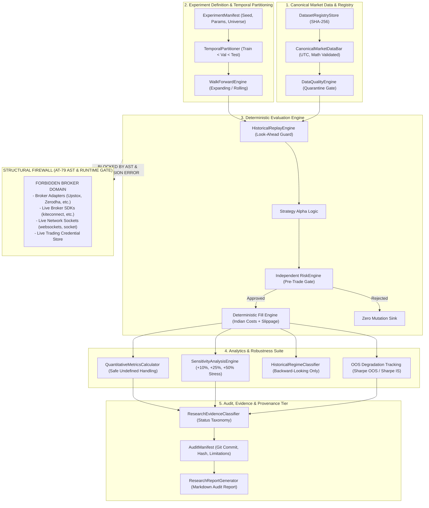
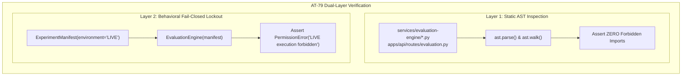

# ALGO LAB — STAGE 7 SPECIFICATION & ACCEPTANCE-TEST MATRIX

```
STATUS: DRAFT
IMPLEMENTATION: NOT APPROVED
BASELINE: stage6-verified / 2c09e57
CERTIFIED STAGE 6 REGRESSION: 192 / 192 TESTS PASSED
```

---

## 1. Executive Summary & Problem Statement

### 1.1 Problem Statement
Algo Lab Stage 6 successfully certified **Market Data, Historical Replay & Paper Trading**, establishing canonical OHLCV data contracts, cryptographic dataset registry validation (SHA-256), strict look-ahead guards in chronological replay, order lifecycle management, in-memory paper trading portfolios with pre-trade cash solvency enforcement, and secret protection.

However, **Stage 6 is insufficient for institutional-grade quantitative research and strategy evaluation**:
1. **Lack of Formal Temporal Partitioning**: Stage 6 allows running replays over continuous historical intervals, but does not provide standardized mechanisms to enforce strictly disjoint in-sample (train), validation, and out-of-sample (test) partitions ($t_{\text{train}} < t_{\text{val}} < t_{\text{test}}$). Without formal temporal barriers, strategy development is susceptible to inadvertent data snooping and in-sample overfitting.
2. **Absence of Systematic Walk-Forward Analysis**: Stage 6 lacks anchored expanding and rolling walk-forward simulation engines with enforced minimum observation horizons, preventing researchers from evaluating strategy regime-adaptability across rolling market cycles.
3. **Absence of Quantitative Robustness & Friction Sensitivity Testing**: Stage 6 models realistic Indian transaction costs and deterministic slippage at fixed parameter levels, but lacks automated sensitivity perturbation sweeps (+10%, +25%, +50% cost stress; 2x/5x slippage stress; parameter neighborhood stability) to prove that strategy profitability is not an artifact of friction underestimation or brittle curve-fitting.
4. **Lack of Objective Evidence Status Classification**: In Stage 6, strategies produce return metrics, but there is no formalized, objective taxonomy (e.g., `INSUFFICIENT_DATA`, `INSUFFICIENT_EVIDENCE`, `OUT_OF_SAMPLE_EVALUATED`, `ROBUSTNESS_TESTED`, `VALIDATED`) that fails closed when trade counts or observation counts are statistically insignificant.
5. **No End-to-End Cryptographic Evaluation Audit Manifests**: While Stage 4 introduced backtest fingerprints and Stage 5 introduced research experiments, there is no end-to-end evaluation manifest that binds input dataset SHA-256 hashes, exact Git commit SHA, strategy configuration, parameter dictionaries, temporal partitions, friction models, and explicit methodological limitations into a single bit-for-bit reproducible record.
6. **Execution Boundary Exposure**: Stage 6 introduced broker adapter abstractions and paper trading sessions. If strategy evaluation pipelines were to inadvertently import, instantiate, or invoke broker execution modules, external execution authority could leak into the research environment.

### 1.2 Stage 7 Mission
Stage 7 establishes the **Research & Strategy Evaluation Layer** atop the certified Stage 5 and Stage 6 foundation. It solves the problem of reproducible, look-ahead-free, statistically guarded strategy evaluation while guaranteeing complete architectural isolation from paper trading order routing and live broker execution.

---

## 2. Scope & Non-Goals

### 2.1 In-Scope Capabilities
Stage 7 introduces and certifies the following research modules and boundaries:
1. **Temporal Partitioning Engine (`TemporalPartitioner`)**:
   - Enforces strictly chronological, non-overlapping partitions ($t_{\text{train\_start}} < t_{\text{train\_end}} \le t_{\text{val\_start}} < t_{\text{val\_end}} \le t_{\text{test\_start}} < t_{\text{test\_end}}$).
   - Fails closed on date inversion, interval overlap, or boundary leakage.
2. **Walk-Forward Simulation Engine (`WalkForwardEngine`)**:
   - Supports both expanding (anchored) and rolling (fixed-window) time slices.
   - Enforces minimum observation sample size gates and positive step sizes.
   - Prevents step $N$ from observing future step $N+1$ data.
3. **Deterministic Evaluation Engine (`EvaluationEngine`)**:
   - Executes strategy evaluation loops over canonical market data using Stage 6 replay and risk gating.
   - Incorporates certified statutory Indian transaction costs (`IndianCostCalculator`) and deterministic slippage (`SlippageCalculator`).
   - Evaluates strategies across in-sample, validation, and out-of-sample partitions independently.
4. **Quantitative Metrics & Trade Distribution Calculator (`QuantitativeMetricsCalculator`)**:
   - Computes return metrics (Total Return, CAGR, MDD, Drawdown Duration, Volatility, Sharpe, Sortino).
   - Computes trade distribution metrics (Total Trades, Win Rate, Profit Factor, Win/Loss P&L, Holding Periods, Streaks).
   - Enforces safe handling of mathematically undefined metrics (zero trades, zero losses, zero volatility) without silent zeroes or division-by-zero crashes.
5. **Robustness & Friction Sensitivity Engine (`SensitivityAnalysisEngine`)**:
   - Evaluates strategy performance under multi-tier cost stress (+10%, +25%, +50%) and slippage multipliers (2x, 5x).
   - Sweeps parameter neighborhoods to detect parameter cliffs and curve-fitting.
   - Enforces that sensitivity analysis never autonomously promotes or deploys strategy variants.
6. **Historical Market Regime Classifier (`HistoricalRegimeClassifier`)**:
   - Classifies historical periods into Bullish, Bearish, Sideways, High Volatility, and Low Volatility regimes using backward-looking indicators only.
   - Fails closed with `INSUFFICIENT_EVIDENCE` if regime sample sizes are below statistical thresholds (<20 bars).
7. **Research Evidence Classification & Audit Manifest Engine**:
   - Formalizes `ResearchEvidenceStatus` enum.
   - Produces immutable `AuditManifest` containing Git commit, dataset SHA-256 hash, parameters, methodology, warnings, and limitations.
   - Generates human-readable, institutional-grade Markdown research evaluation reports.
8. **Structural & Behavioral Isolation Gates (AT-79)**:
   - Implements static AST analysis verifying zero imports or dependencies on broker adapters, broker SDKs, live execution modules, or network sockets in the evaluation package.
   - Implements behavioral lockout failing closed with `PermissionError` if `ExecutionEnvironment.LIVE` is configured.

### 2.2 Explicit Non-Goals (Hard Architectural Exclusions)
The following capabilities are strictly forbidden and excluded from Stage 7:
- **Zero Live Trading**: No connection to live broker trading APIs (Zerodha Kite, Upstox, Interactive Brokers, etc.).
- **Zero Autonomous Execution**: No autonomous order routing, trade activation, or auto-promotion of research strategies to production.
- **Zero AI Trading Authority**: AI may assist in explaining metrics, generating research summaries, or surfacing caveats, but AI models must never make or override trading, sizing, or risk decisions.
- **Zero Uncontrolled External Execution**: Strategy evaluation must run strictly inside an isolated in-memory simulation loop.
- **No Options Chain Modeling**: Equity/cash spot canonical data only (options chains excluded until a dedicated derivatives stage).
- **No Live WebSocket Streaming**: Evaluation operates solely on certified canonical historical bars; live tick/quote streaming is out of scope.
- **Zero Weakening of Stage 6 Guarantees**: All 192 certified tests and 15 invariants from Stage 6 must remain 100% intact and passing.

---

## 3. System Architecture & Data Flow

### 3.1 Architectural Topology



### 3.2 Component Boundaries & Responsibilities

| Component Boundary | Primary Responsibility | Inbound Dependencies | Outbound Permissions | Prohibited Actions |
|---|---|---|---|---|
| **Market Data** | Canonical bar normalization, UTC conversion, SHA-256 fingerprinting, quarantine enforcement | Raw data files, SQLite cache | Read-only access by ReplayEngine | Modifying data in place, silent NaN interpolation |
| **Research / Evaluation** | Orchestrating experiments, partitioning, walk-forward, metrics calculation | Market data, Strategy contracts, Cost models | Outputs `EvaluationSummary`, `AuditManifest` | Calling broker APIs, importing paper adapter credentials |
| **Strategy Layer** | Computing alpha signals from historical bar slices | CanonicalMarketDataBar sequence $\le t$ | Proposes `ExecutionOrder` candidates | Accessing future bars, knowing fill price before fill |
| **Risk Engine** | Independent gate evaluating portfolio limits, stop-loss, solvency | Proposed order, current portfolio state | `ORDER_ACCEPTED` or `ORDER_REJECTED` | Overridden by AI, mutated on rejection |
| **Execution Simulation** | In-memory fill calculation with statutory Indian taxes and slippage | Approved orders, bar prices | Produces `ExecutionFill` records | Sending network packets, routing to real exchanges |
| **Paper Trading** | Session-based forward simulation with mock broker | API triggers, replay feeds | Local SQLite session records | Executing real capital (`LIVE` hard-disabled) |
| **Broker Abstraction** | Provider interface definition (`PaperExecutionProvider`) | Credential config store | Test connection, simulated fills | Exposing plain-text secrets, live order routing |
| **Audit & Provenance** | Immutable recording of runs, hashes, parameters, and limitations | Engine outputs, Git commit metadata | JSON manifests, Markdown reports | Tampering with run history, silent parameter omission |
| **API Layer** | FastAPI routers for managing datasets, experiments, reports | HTTP clients, UI requests | Invoking core services | Passing execution credentials to evaluation |
| **UI Layer** | Web visualization of research metrics, equity curves, degradation | API responses | User display | Gamified metrics, automated trade triggers |
| **AI Assistance** | Natural language summarization, explanation of metrics and caveats | Read-only evaluation summaries | Text explanation strings | Autonomous trading, overriding risk controls |

---

## 4. Determinism & No-Lookahead Guarantees

### 4.1 Determinism Requirements
1. **Deterministic Inputs**: Market data bars must be strictly ordered by `(timestamp ASC, symbol ASC)`. Datasets must match their registered SHA-256 checksums exactly.
2. **Deterministic Evaluation**: Given identical `(ExperimentManifest, Dataset, Random Seed)`, the evaluation engine must produce identical fill prices, fees, equity curves, and performance metrics down to floating-point precision ($10^{-9}$).
3. **Deterministic Configuration**: All configuration parameters must be serializable and hashed. Any modification to parameters must result in a different configuration hash.
4. **Reproducibility from Manifest**: An evaluation run must be 100% reproducible solely by providing the generated `AuditManifest` and registered dataset to the engine.

### 4.2 No-Lookahead Guarantees
1. **Temporal Horizon Guard**: At simulation time $t_{\text{sim}}$, the strategy and indicators have access strictly to bars with $\text{timestamp} \le t_{\text{sim}}$. Attempting to peek at $\text{timestamp} > t_{\text{sim}}$ raises `LookAheadBiasError`.
2. **Feature & Indicator Availability**: Technical indicators (EMA, VWAP, RSI, Bollinger Bands, ATR) must be calculated on closed bars prior to the decision point. Intraday bars must not include subsequent high/low/close values.
3. **Execution Delay Realism**: Orders proposed on the close of bar $t$ are filled either at the close with realistic slippage or on the open of bar $t+1$. A strategy can never trade at price $P_t$ based on conditions evaluated at $P_{t+k}$ ($k > 0$).
4. **Cross-Symbol Temporal Isolation**: In multi-symbol portfolios, synchronous bar delivery ensures no symbol's future bar is visible before another symbol's contemporary bar is processed.

---

## 5. Evaluation / Execution Structural Isolation & AT-79 Specification

### 5.1 Architectural Firewall Principle
The research evaluation engine must remain an offline, analytical instrument. It must **never possess the capability, dependencies, or credentials to route orders to external brokers or live execution venues**.

### 5.2 AT-79: Structural AST and Behavioral Isolation Test
AT-79 is a mandatory acceptance test that enforces isolation both statically (at code structure level) and dynamically (at runtime):



#### Layer 1: Static AST Verification
1. Dynamically resolves the project root using `Path(__file__).resolve().parents[2]` (or equivalent relative anchor) to avoid environment-specific hardcoded paths.
2. Discovers all `.py` files in `services/evaluation-engine/` and Stage 7 evaluation API routes.
3. Parses every file using `ast.parse` and walks all `ast.Import` and `ast.ImportFrom` nodes.
4. Validates that **zero imports** match any pattern in the forbidden modules list:
   - `services.paper_engine.adapters`
   - `services.paper-engine.adapters`
   - `services.execution_engine`
   - `services.execution-engine`
   - `kiteconnect`
   - `upstox_client`
   - `interactive_brokers`
   - `ib_insync`
   - `alpaca_trade_api`
   - `smartapi`
   - `NorenApi`
   - `websockets`
   - `socket`
5. Validates that dynamic import evasion mechanisms (`__import__`, `importlib.import_module`, `eval`, `exec`) targeting broker execution are absent.
6. Any violation immediately causes the test to fail with an explicit diagnostic naming the offending file, line number, and imported module.

#### Layer 2: Behavioral Lockout
1. Attempting to construct an `ExperimentManifest` or initialize `EvaluationEngine` with `environment="LIVE"` fails closed immediately by raising `PermissionError`.
2. Evaluation configuration schemas do not include broker API key or secret fields.

---

## 6. The 18 Stage 7 Architectural Invariants

| Invariant ID | Name | Formal Definition | Verification Test(s) |
|---|---|---|---|
| **INV-01** | **Deterministic Experiment** | Same experiment configuration + same dataset + same seed = bit-for-bit identical results across runs. | AT-01, AT-22, AT-26, AT-31, AT-54, AT-59, AT-64, AT-83, AT-90 |
| **INV-02** | **No Look-Ahead Bias** | Information at time $t > t_{\text{sim}}$ cannot be accessed or influence decisions at simulation time $t$. | AT-18, AT-19, AT-20, AT-21, AT-30, AT-60, AT-82 |
| **INV-03** | **Temporal Isolation** | Train, validation, and test periods are strictly disjoint and chronological ($t_{\text{train}} < t_{\text{val}} < t_{\text{test}}$). | AT-04, AT-13, AT-14, AT-15, AT-16, AT-17, AT-23, AT-24, AT-26, AT-27, AT-30, AT-62, AT-63 |
| **INV-04** | **Final Test Isolation** | Information from the final test period cannot be used for parameter selection, model tuning, or feature selection. | AT-25 |
| **INV-05** | **Dataset Identity** | Every research evaluation explicitly records the exact dataset identifier, timeframe, universe, and version. | AT-03, AT-07, AT-68 |
| **INV-06** | **Dataset Integrity** | Unexpected data modifications, missing OHLCV fields, or SHA-256 checksum drift fail closed immediately. | AT-07, AT-08, AT-09, AT-10, AT-11, AT-12, AT-32, AT-69 |
| **INV-07** | **Cost Model Consistency** | Research evaluation must use the certified statutory Indian transaction cost calculator (brokerage, STT, GST, etc.). | AT-34, AT-35, AT-37, AT-54, AT-55, AT-72 |
| **INV-08** | **Slippage Model Consistency** | Research evaluation must use certified slippage friction models; zero frictionless simulations are permitted. | AT-36, AT-56, AT-72 |
| **INV-09** | **Invalid Experiment Rejection** | Incomplete, contradictory, or unphysical experiment configurations fail closed before simulation starts. | AT-01, AT-02, AT-03, AT-04, AT-05, AT-06, AT-10, AT-12, AT-14, AT-15, AT-16, AT-17, AT-25, AT-28, AT-29, AT-87 |
| **INV-10** | **Metric Integrity** | Mathematically undefined metrics (e.g., zero trades, zero losing trades) must never be silently returned as zero. | AT-38, AT-39, AT-40, AT-41, AT-42, AT-43, AT-44, AT-45, AT-46, AT-47, AT-48, AT-49, AT-50, AT-51, AT-52, AT-53, AT-65 |
| **INV-11** | **Reproducibility** | Any experiment result must be fully reproducible from its persisted audit manifest alone. | AT-31, AT-57, AT-67, AT-73, AT-90 |
| **INV-12** | **Auditability** | Complete execution metadata (Git commit, seed, configuration, dataset hash, limitations) is persisted immutably. | AT-22, AT-23, AT-24, AT-33, AT-47, AT-62, AT-63, AT-64, AT-67, AT-68, AT-69, AT-70, AT-71, AT-73, AT-74, AT-75 |
| **INV-13** | **Secret Protection** | Zero credentials, API tokens, or secrets may appear in research manifests, logs, summaries, or reports. | AT-77, AT-78 |
| **INV-14** | **Stage 6 Preservation** | Certified Stage 6 replay determinism, cash solvency, risk gating, and paper trading controls remain intact. | AT-06, AT-34, AT-37, AT-80, AT-81, AT-82, AT-83, AT-84, AT-85 |
| **INV-15** | **Live Trading Isolation** | Stage 7 evaluation modules have zero structural imports of broker adapters and zero runtime paths to live trading. | AT-79, AT-80 |
| **INV-16** | **No Autonomous Selection** | Optimization or research evaluation never automatically selects or deploys a strategy into paper or live trading. | AT-58 |
| **INV-17** | **Insufficient Evidence** | "Insufficient evidence" is a formal first-class research status, not an error or disguised pass. | AT-28, AT-45, AT-46, AT-61, AT-66, AT-88 |
| **INV-18** | **Limitation Disclosure** | All material methodological assumptions, caveats, and data limitations are explicitly reported in outputs. | AT-11, AT-55, AT-56, AT-57, AT-61, AT-65, AT-75, AT-76, AT-86, AT-87, AT-88, AT-89 |

---

## 7. Certified Acceptance Test Matrix: AT-01 through AT-90

The acceptance matrix contains 90 certified requirements across 18 specialized research areas. Every test must pass with zero failures, zero errors, zero skipped tests, and zero xfail markers.

### Area 1: Experiment Configuration & Boundary Validation (AT-01 to AT-06)
- **AT-01: Valid Experiment Manifest Creation**
  - *Requirement*: A properly configured experiment manifest must be accepted with a generated ID, strategy identity, parameters, and capital.
  - *Preconditions*: Valid parameters, initial capital > 0, valid dates.
  - *Action*: Instantiate `ExperimentManifest`.
  - *Expected Result*: Manifest instance created; fields accessible.
  - *Failure Condition*: Validation error on valid inputs.
  - *Test Type*: Behavioral | *Affected Component*: `contracts.py` | *Integrity*: INV-01, INV-09 | *Regression*: Stage 6 contracts.
- **AT-02: Missing Strategy Identity Rejection**
  - *Requirement*: An experiment without strategy identity must be rejected fail-closed.
  - *Preconditions*: None.
  - *Action*: Instantiate `ExperimentManifest` with empty strategy_id.
  - *Expected Result*: Raises `ValidationError` or `ValueError`.
  - *Failure Condition*: Manifest created with missing strategy ID.
  - *Test Type*: Behavioral | *Affected Component*: `contracts.py` | *Integrity*: INV-09 | *Regression*: Stage 6 validation.
- **AT-03: Missing Dataset Identity Rejection**
  - *Requirement*: An experiment without dataset identity must be rejected fail-closed.
  - *Preconditions*: None.
  - *Action*: Instantiate `ExperimentManifest` with empty dataset_id.
  - *Expected Result*: Raises `ValidationError` or `ValueError`.
  - *Failure Condition*: Manifest created without dataset ID.
  - *Test Type*: Behavioral | *Affected Component*: `contracts.py` | *Integrity*: INV-05, INV-09 | *Regression*: Stage 6 validation.
- **AT-04: Inverted / Invalid Date Range Rejection**
  - *Requirement*: Start date $\ge$ end date must fail closed.
  - *Preconditions*: None.
  - *Action*: Construct manifest where start date $\ge$ end date.
  - *Expected Result*: Raises `ValueError`.
  - *Failure Condition*: Invalid date range accepted.
  - *Test Type*: Behavioral | *Affected Component*: `contracts.py` | *Integrity*: INV-03, INV-09 | *Regression*: Stage 6 validation.
- **AT-05: Unsupported / Invalid Timeframe Rejection**
  - *Requirement*: Unsupported timeframe strings must fail closed.
  - *Preconditions*: None.
  - *Action*: Construct manifest with invalid timeframe (e.g., `"2hours"`).
  - *Expected Result*: Raises `ValidationError` or `ValueError`.
  - *Failure Condition*: Unsupported timeframe accepted.
  - *Test Type*: Behavioral | *Affected Component*: `contracts.py` | *Integrity*: INV-09 | *Regression*: Stage 6 validation.
- **AT-06: Non-Positive Initial Capital Rejection**
  - *Requirement*: Zero or negative initial capital must fail closed.
  - *Preconditions*: None.
  - *Action*: Construct manifest with capital $\le 0.0$.
  - *Expected Result*: Raises `ValidationError` or `ValueError`.
  - *Failure Condition*: Zero/negative capital accepted.
  - *Test Type*: Behavioral | *Affected Component*: `contracts.py` | *Integrity*: INV-09, INV-14 | *Regression*: Stage 6 cash safety.

### Area 2: Dataset Integrity, Checksums & Quarantine Handling (AT-07 to AT-12)
- **AT-07: Valid Dataset Loading & Verification**
  - *Requirement*: A registered canonical dataset must load cleanly and verify.
  - *Preconditions*: Valid dataset registered in `DatasetRegistryStore`.
  - *Action*: Load dataset via registry.
  - *Expected Result*: Dataset status is verified.
  - *Failure Condition*: Load fails on valid data.
  - *Test Type*: Behavioral | *Affected Component*: `engine.py`, `registry.py` | *Integrity*: INV-05, INV-06 | *Regression*: Stage 6 registry.
- **AT-08: Dataset SHA-256 Checksum Validation**
  - *Requirement*: Computed bar checksum matches registry SHA-256 fingerprint.
  - *Preconditions*: Dataset stored with known checksum.
  - *Action*: Compute SHA-256 and compare.
  - *Expected Result*: Exact hash match.
  - *Failure Condition*: Hash mismatch or silent drift.
  - *Test Type*: Behavioral | *Affected Component*: `registry.py` | *Integrity*: INV-01, INV-06 | *Regression*: Stage 6 registry.
- **AT-09: Dataset Checksum Mismatch Detection**
  - *Requirement*: Tampered dataset content fails closed.
  - *Preconditions*: Dataset modified after registration.
  - *Action*: Validate checksum of tampered dataset.
  - *Expected Result*: Raises `DatasetDriftError` or `DatasetIntegrityError`.
  - *Failure Condition*: Tampered data accepted without error.
  - *Test Type*: Behavioral | *Affected Component*: `registry.py` | *Integrity*: INV-06 | *Regression*: Stage 6 registry.
- **AT-10: Missing Required OHLCV Field Detection**
  - *Requirement*: Bars missing required OHLCV fields must be rejected fail-closed.
  - *Preconditions*: None.
  - *Action*: Validate bar missing `volume` or `close`.
  - *Expected Result*: Raises `ValidationError`.
  - *Failure Condition*: Incomplete bar accepted.
  - *Test Type*: Behavioral | *Affected Component*: `canonical_market_data.py` | *Integrity*: INV-06, INV-09 | *Regression*: Stage 6 data contracts.
- **AT-11: Dataset Discontinuity / Missing Bar Detection**
  - *Requirement*: Large unexpected gaps in trading bars must be flagged with a warning or rejection.
  - *Preconditions*: Bar sequence with 30-day missing gap during trading season.
  - *Action*: Run evaluation data validation.
  - *Expected Result*: Diagnostic warning added to audit manifest.
  - *Failure Condition*: Gaps silently ignored without warning.
  - *Test Type*: Behavioral | *Affected Component*: `engine.py` | *Integrity*: INV-06, INV-18 | *Regression*: Stage 6 validation.
- **AT-12: Quarantined Dataset Usage Rejection**
  - *Requirement*: Attempting evaluation on a quarantined dataset must fail closed.
  - *Preconditions*: Dataset marked with `DataQualityStatus.QUARANTINED`.
  - *Action*: Initialize evaluation engine with quarantined dataset.
  - *Expected Result*: Raises `PermissionError` or `RuntimeError`.
  - *Failure Condition*: Quarantined data processed for strategy evaluation.
  - *Test Type*: Behavioral | *Affected Component*: `engine.py` | *Integrity*: INV-06, INV-09 | *Regression*: Stage 6 data quality.

### Area 3: Temporal Partitioning & Overlap Prevention (AT-13 to AT-17)
- **AT-13: Valid Disjoint Partition Creation**
  - *Requirement*: `TemporalPartition` enforces strictly ordered chronological boundaries ($t_{\text{train}} < t_{\text{val}} < t_{\text{test}}$).
  - *Preconditions*: Non-overlapping chronological dates.
  - *Action*: Instantiate `TemporalPartition`.
  - *Expected Result*: Partition successfully created.
  - *Failure Condition*: Valid partition rejected.
  - *Test Type*: Behavioral | *Affected Component*: `partitioning.py` | *Integrity*: INV-03 | *Regression*: None.
- **AT-14: Training / Validation Overlap Rejection**
  - *Requirement*: Overlap between train end and val start must fail closed.
  - *Preconditions*: `train_end > val_start`.
  - *Action*: Instantiate `TemporalPartition`.
  - *Expected Result*: Raises `InvalidPartitionError`.
  - *Failure Condition*: Overlapping train/val accepted.
  - *Test Type*: Behavioral | *Affected Component*: `partitioning.py` | *Integrity*: INV-03, INV-09 | *Regression*: None.
- **AT-15: Validation / Final Test Overlap Rejection**
  - *Requirement*: Overlap between val end and test start must fail closed.
  - *Preconditions*: `val_end > test_start`.
  - *Action*: Instantiate `TemporalPartition`.
  - *Expected Result*: Raises `InvalidPartitionError`.
  - *Failure Condition*: Overlapping val/test accepted.
  - *Test Type*: Behavioral | *Affected Component*: `partitioning.py` | *Integrity*: INV-03, INV-09 | *Regression*: None.
- **AT-16: Training Extends Into Final Test Rejection**
  - *Requirement*: When no validation split exists, train extending past test start must fail closed.
  - *Preconditions*: `train_end > test_start`.
  - *Action*: Instantiate `TemporalPartition`.
  - *Expected Result*: Raises `InvalidPartitionError`.
  - *Failure Condition*: Overlapping train/test accepted.
  - *Test Type*: Behavioral | *Affected Component*: `partitioning.py` | *Integrity*: INV-03, INV-09 | *Regression*: None.
- **AT-17: Chronologically Inverted Partitions Rejection**
  - *Requirement*: Partitions where test precedes train must fail closed.
  - *Preconditions*: `test_start < train_start`.
  - *Action*: Instantiate `TemporalPartition`.
  - *Expected Result*: Raises `InvalidPartitionError`.
  - *Failure Condition*: Inverted partitions accepted.
  - *Test Type*: Behavioral | *Affected Component*: `partitioning.py` | *Integrity*: INV-03, INV-09 | *Regression*: None.

### Area 4: Look-Ahead Bias Prevention (AT-18 to AT-21)
- **AT-18: Future Bar Access Prohibition**
  - *Requirement*: Attempting to read bar $t+k$ ($k>0$) during simulation at time $t$ raises `LookAheadBiasError`.
  - *Preconditions*: HistoricalReplayEngine running at time $t$.
  - *Action*: Strategy queries bar at $t+1$.
  - *Expected Result*: Replay engine raises `LookAheadBiasError`.
  - *Failure Condition*: Future bar data leaked to strategy.
  - *Test Type*: Behavioral | *Affected Component*: `replay.py`, `engine.py` | *Integrity*: INV-02 | *Regression*: Stage 6 replay.
- **AT-19: Future Indicator Value Access Prohibition**
  - *Requirement*: Technical indicators must be computed solely on bars $\le t_{\text{sim}}$.
  - *Preconditions*: Technical indicators instantiated.
  - *Action*: Calculate indicators during replay step.
  - *Expected Result*: Indicator value matches historical slice calculation exactly.
  - *Failure Condition*: Indicator incorporates future prices.
  - *Test Type*: Behavioral | *Affected Component*: `quant/indicators`, `engine.py` | *Integrity*: INV-02 | *Regression*: Stage 3/5 indicators.
- **AT-20: Future Portfolio State Access Prohibition**
  - *Requirement*: Strategy cannot inspect future equity or trade outcomes.
  - *Preconditions*: Portfolio state tracking.
  - *Action*: Inspect portfolio state during signal generation.
  - *Expected Result*: Only current realized cash and marked positions visible.
  - *Failure Condition*: Future equity accessible.
  - *Test Type*: Behavioral | *Affected Component*: `engine.py` | *Integrity*: INV-02 | *Regression*: Stage 6 paper portfolio.
- **AT-21: Future Trade Outcome Leakage Prevention**
  - *Requirement*: Decision at $t$ cannot depend on execution fill price before fill occurs.
  - *Preconditions*: Order proposal pending.
  - *Action*: Query fill details before execution lifecycle processes fill.
  - *Expected Result*: Fill is unpopulated until simulated execution step.
  - *Failure Condition*: Fill price leaked to proposal logic.
  - *Test Type*: Behavioral | *Affected Component*: `engine.py`, `execution_lifecycle.py` | *Integrity*: INV-02 | *Regression*: Stage 6 lifecycle.

### Area 5: Parameter Selection & Leakage Detection (AT-22 to AT-25)
- **AT-22: Fixed Parameter Evaluation Run**
  - *Requirement*: Static predefined parameters are evaluated and recorded as fixed in the audit manifest.
  - *Preconditions*: Manifest with explicit parameters.
  - *Action*: Execute evaluation.
  - *Expected Result*: Results recorded with parameter provenance.
  - *Failure Condition*: Parameters omitted or altered during run.
  - *Test Type*: Behavioral | *Affected Component*: `engine.py` | *Integrity*: INV-01, INV-12 | *Regression*: None.
- **AT-23: Training-Set Parameter Calibration**
  - *Requirement*: Parameters tuned on the training partition must be tagged as calibrated on train only.
  - *Preconditions*: Training partition specified.
  - *Action*: Calibrate parameters on train partition.
  - *Expected Result*: Parameter provenance notes train partition interval.
  - *Failure Condition*: Untracked parameter calibration.
  - *Test Type*: Behavioral | *Affected Component*: `engine.py` | *Integrity*: INV-03, INV-12 | *Regression*: None.
- **AT-24: Validation-Set Hyperparameter Selection**
  - *Requirement*: Hyperparameter selection on validation partition is recorded without test leakage.
  - *Preconditions*: Train and validation partitions defined.
  - *Action*: Select top parameters on validation partition.
  - *Expected Result*: Selected config recorded with validation metadata.
  - *Failure Condition*: Validation selection accesses final test data.
  - *Test Type*: Behavioral | *Affected Component*: `engine.py` | *Integrity*: INV-03, INV-12 | *Regression*: None.
- **AT-25: Final-Test Parameter Optimization Rejection**
  - *Requirement*: Attempting parameter search or tuning over the final test partition fails closed.
  - *Preconditions*: Experiment configured with tuning enabled on final test partition.
  - *Action*: Execute optimization run.
  - *Expected Result*: Raises `DataLeakageError` or `ValueError`.
  - *Failure Condition*: Optimization allowed over final test period.
  - *Test Type*: Behavioral | *Affected Component*: `engine.py` | *Integrity*: INV-04, INV-09 | *Regression*: None.

### Area 6: Walk-Forward Simulation & Window Bounds (AT-26 to AT-30)
- **AT-26: Expanding Window Walk-Forward Execution**
  - *Requirement*: WalkForwardEngine executes expanding windows where train window grows deterministically.
  - *Preconditions*: `WindowType.EXPANDING`, step size > 0.
  - *Action*: Generate and evaluate expanding slices.
  - *Expected Result*: Train window start remains anchored; end date expands by step size.
  - *Failure Condition*: Windows non-expanding or non-chronological.
  - *Test Type*: Behavioral | *Affected Component*: `walk_forward.py` | *Integrity*: INV-01, INV-03 | *Regression*: None.
- **AT-27: Rolling Window Walk-Forward Execution**
  - *Requirement*: WalkForwardEngine executes rolling windows where window length remains fixed.
  - *Preconditions*: `WindowType.ROLLING`, fixed window size, step size > 0.
  - *Action*: Generate and evaluate rolling slices.
  - *Expected Result*: Both start and end advance by step size; window length constant.
  - *Failure Condition*: Window length drifts or step size violates configuration.
  - *Test Type*: Behavioral | *Affected Component*: `walk_forward.py` | *Integrity*: INV-01, INV-03 | *Regression*: None.
- **AT-28: Sub-Minimum Observation Window Rejection**
  - *Requirement*: Evaluation slices with fewer observations than `min_observations` fail closed or flag `INSUFFICIENT_EVIDENCE`.
  - *Preconditions*: Dataset with 10 bars where `min_observations=50`.
  - *Action*: Execute walk-forward configuration.
  - *Expected Result*: Fails closed or returns `INSUFFICIENT_EVIDENCE`.
  - *Failure Condition*: Evaluation produces positive validation on sub-minimum observations.
  - *Test Type*: Behavioral | *Affected Component*: `walk_forward.py`, `engine.py` | *Integrity*: INV-09, INV-17 | *Regression*: None.
- **AT-29: Invalid Step Size (Zero or Negative) Rejection**
  - *Requirement*: Step size $\le 0$ fails closed.
  - *Preconditions*: WalkForwardConfig with step size = 0.
  - *Action*: Instantiate `WalkForwardConfig`.
  - *Expected Result*: Raises `ValidationError` or `ValueError`.
  - *Failure Condition*: Non-positive step size accepted.
  - *Test Type*: Behavioral | *Affected Component*: `walk_forward.py` | *Integrity*: INV-09 | *Regression*: None.
- **AT-30: Walk-Forward Future Step Leakage Rejection**
  - *Requirement*: Evaluation at slice $N$ has zero access to data from slice $N+1$.
  - *Preconditions*: Walk-forward slices $N$ and $N+1$.
  - *Action*: Run slice $N$ and verify data bounds.
  - *Expected Result*: Max timestamp in slice $N \le t_{\text{slice\_N\_end}}$.
  - *Failure Condition*: Slice $N$ accesses data $> t_{\text{slice\_N\_end}}$.
  - *Test Type*: Behavioral | *Affected Component*: `walk_forward.py` | *Integrity*: INV-02, INV-03 | *Regression*: None.

### Area 7: Replay Determinism & Perturbation Sensitivity (AT-31 to AT-33)
- **AT-31: Deterministic Re-execution Invariance**
  - *Requirement*: Executing the same experiment twice produces identical trades, metrics, and equity curve.
  - *Preconditions*: Fixed dataset and manifest.
  - *Action*: Run evaluation twice.
  - *Expected Result*: Bit-for-bit identical results; metric deltas = 0.0.
  - *Failure Condition*: Non-deterministic metric variation.
  - *Test Type*: Behavioral | *Affected Component*: `engine.py` | *Integrity*: INV-01, INV-11 | *Regression*: Stage 6 replay determinism.
- **AT-32: Data Perturbation Sensitivity Detection**
  - *Requirement*: Modifying bar prices alters output metrics deterministically.
  - *Preconditions*: Dataset A and modified Dataset B.
  - *Action*: Run evaluation on both datasets.
  - *Expected Result*: Metrics differ; manifests record distinct dataset SHA-256 hashes.
  - *Failure Condition*: Metrics identical despite data change, or hash unchanged.
  - *Test Type*: Behavioral | *Affected Component*: `engine.py` | *Integrity*: INV-01, INV-06 | *Regression*: None.
- **AT-33: Strategy Logic Version Drift Detection**
  - *Requirement*: Incrementing strategy version produces distinct audit record.
  - *Preconditions*: Strategy version "1.0.0" vs "1.0.1".
  - *Action*: Run evaluation under both versions.
  - *Expected Result*: Manifests record distinct strategy versions.
  - *Failure Condition*: Version drift not captured in audit trail.
  - *Test Type*: Behavioral | *Affected Component*: `engine.py` | *Integrity*: INV-01, INV-12 | *Regression*: None.

### Area 8: Certified Cost & Slippage Frictions (AT-34 to AT-37)
- **AT-34: Statutory Indian Cost Inclusion**
  - *Requirement*: Net trade P&L must reflect Indian statutory taxes (STT, GST, turnover, stamp duty, brokerage).
  - *Preconditions*: Standard `CostModelConfig`.
  - *Action*: Execute trades in evaluation engine.
  - *Expected Result*: `net_pnl == gross_pnl - costs - slippage`.
  - *Failure Condition*: Frictionless trades or omitted tax categories.
  - *Test Type*: Behavioral | *Affected Component*: `engine.py`, `cost_models.py` | *Integrity*: INV-07, INV-14 | *Regression*: Stage 6 cost models.
- **AT-35: Brokerage Configuration Sensitivity**
  - *Requirement*: Altering brokerage fees changes net return monotonically.
  - *Preconditions*: Fee tier 1 vs Fee tier 2.
  - *Action*: Run evaluation under both fee configs.
  - *Expected Result*: Higher brokerage produces lower net P&L.
  - *Failure Condition*: Net returns unchanged by fee modifications.
  - *Test Type*: Behavioral | *Affected Component*: `cost_models.py`, `engine.py` | *Integrity*: INV-07 | *Regression*: Stage 6 cost models.
- **AT-36: Slippage Parameter Sensitivity**
  - *Requirement*: Altering slippage points changes fill prices and net returns deterministically.
  - *Preconditions*: 0.1 pt vs 0.5 pt slippage.
  - *Action*: Run evaluation under both slippage configs.
  - *Expected Result*: Higher slippage degrades net P&L.
  - *Failure Condition*: Fill prices unaffected by slippage config.
  - *Test Type*: Behavioral | *Affected Component*: `cost_models.py`, `engine.py` | *Integrity*: INV-08 | *Regression*: Stage 6 slippage.
- **AT-37: Independent Cost Engine Equivalence**
  - *Requirement*: Evaluation engine cost calculations match `IndianCostCalculator` from Stage 6 exactly.
  - *Preconditions*: Identical trade price and quantity.
  - *Action*: Compare evaluation cost output against direct `IndianCostCalculator.calculate_all_costs` call.
  - *Expected Result*: Exact float equivalence.
  - *Failure Condition*: Cost divergence between evaluation and Stage 6 calculator.
  - *Test Type*: Behavioral | *Affected Component*: `cost_models.py` | *Integrity*: INV-07, INV-14 | *Regression*: Stage 6 cost calculator.

### Area 9: Return, Risk & Undefined Metric Integrity (AT-38 to AT-46)
- **AT-38: Total Return Calculation Accuracy**
  - *Requirement*: Total return matches $(\text{Equity}_{\text{end}} - \text{Equity}_0) / \text{Equity}_0$.
  - *Preconditions*: Known equity series.
  - *Action*: Compute return metrics via `QuantitativeMetricsCalculator`.
  - *Expected Result*: Exact mathematical match.
  - *Failure Condition*: Return calculation error.
  - *Test Type*: Behavioral | *Affected Component*: `metrics.py` | *Integrity*: INV-10 | *Regression*: Stage 4/5 metrics.
- **AT-39: CAGR Calculation with Standard Convention**
  - *Requirement*: Annualized return computed correctly with calendar year fraction $(1 + R)^{365.25 / \text{days}} - 1$.
  - *Preconditions*: Multi-day equity curve.
  - *Action*: Compute CAGR via `QuantitativeMetricsCalculator`.
  - *Expected Result*: Exact CAGR matching formula.
  - *Failure Condition*: Arbitrary scaling or division-by-zero on single-day runs.
  - *Test Type*: Behavioral | *Affected Component*: `metrics.py` | *Integrity*: INV-10 | *Regression*: Stage 4/5 metrics.
- **AT-40: Maximum Drawdown (MDD) Calculation Accuracy**
  - *Requirement*: Peak-to-trough calculation verified against known series.
  - *Preconditions*: Synthesized equity series with known 20% drawdown.
  - *Action*: Compute risk metrics.
  - *Expected Result*: MDD matches -0.20 ($\pm 10^{-6}$).
  - *Failure Condition*: Inaccurate drawdown calculation.
  - *Test Type*: Behavioral | *Affected Component*: `metrics.py` | *Integrity*: INV-10 | *Regression*: Stage 4/5 metrics.
- **AT-41: Annualized Volatility Calculation Accuracy**
  - *Requirement*: Periodic return standard deviation scaled by $\sqrt{252}$.
  - *Preconditions*: Daily return series.
  - *Action*: Compute annualized volatility.
  - *Expected Result*: Standard deviation $\times \sqrt{252}$.
  - *Failure Condition*: Unscaled or improperly scaled volatility.
  - *Test Type*: Behavioral | *Affected Component*: `metrics.py` | *Integrity*: INV-10 | *Regression*: Stage 4/5 metrics.
- **AT-42: Sharpe Ratio Annualization & Risk-Free Rate**
  - *Requirement*: Excess return over risk-free rate divided by annualized volatility; safely handled when volatility is zero.
  - *Preconditions*: Constant equity curve (zero volatility).
  - *Action*: Compute Sharpe ratio.
  - *Expected Result*: Returns 0.0 or `None`; no `ZeroDivisionError`.
  - *Failure Condition*: Division-by-zero crash.
  - *Test Type*: Behavioral | *Affected Component*: `metrics.py` | *Integrity*: INV-10 | *Regression*: Stage 4/5 metrics.
- **AT-43: Sortino Ratio & Downside Deviation**
  - *Requirement*: Downside deviation uses negative returns only; safely handles zero downside deviation.
  - *Preconditions*: Strategy with zero losing periods.
  - *Action*: Compute Sortino ratio.
  - *Expected Result*: Returns `None` or finite capped representation; no crash.
  - *Failure Condition*: Crash on zero downside deviation.
  - *Test Type*: Behavioral | *Affected Component*: `metrics.py` | *Integrity*: INV-10 | *Regression*: Stage 4/5 metrics.
- **AT-44: Zero Winning Trades Handling**
  - *Requirement*: Win rate returns 0.0 without division-by-zero error when all trades lose.
  - *Preconditions*: Trade list with only losing trades.
  - *Action*: Compute trade statistics.
  - *Expected Result*: `win_rate == 0.0`.
  - *Failure Condition*: Division-by-zero crash or NaN.
  - *Test Type*: Behavioral | *Affected Component*: `metrics.py` | *Integrity*: INV-10 | *Regression*: None.
- **AT-45: Zero Losing Trades Handling**
  - *Requirement*: Profit factor returns explicitly undefined / None flag when losses = 0.0, never silently 0.0.
  - *Preconditions*: Trade list with only winning trades.
  - *Action*: Compute trade statistics.
  - *Expected Result*: `profit_factor is None` (or documented representation).
  - *Failure Condition*: Returns 0.0 (falsely implying zero profit) or crashes.
  - *Test Type*: Behavioral | *Affected Component*: `metrics.py` | *Integrity*: INV-10, INV-17 | *Regression*: None.
- **AT-46: Empty Trade Set Metric Integrity**
  - *Requirement*: Strategy producing zero trades marks metrics safely with explicit explanation.
  - *Preconditions*: Empty trade list.
  - *Action*: Compute metrics on empty trade list.
  - *Expected Result*: `total_trades == 0`, ratios `None`, evidence status = `INSUFFICIENT_EVIDENCE`.
  - *Failure Condition*: Crashes or reports default winning metrics.
  - *Test Type*: Behavioral | *Affected Component*: `metrics.py`, `engine.py` | *Integrity*: INV-10, INV-17 | *Regression*: None.

### Area 10: Trade Distribution & Holding Statistics (AT-47 to AT-52)
- **AT-47: Total Trade Count & Directional Split**
  - *Requirement*: Long/short trade counts match fill records exactly.
  - *Preconditions*: Executed evaluation with mixed long and short trades.
  - *Action*: Calculate trading metrics.
  - *Expected Result*: `total_trades == long_trades + short_trades`.
  - *Failure Condition*: Count mismatch.
  - *Test Type*: Behavioral | *Affected Component*: `metrics.py` | *Integrity*: INV-10, INV-12 | *Regression*: None.
- **AT-48: Win/Loss Count & Average P&L Statistics**
  - *Requirement*: Gross and net win/loss counts and average trade P&L computed correctly.
  - *Preconditions*: List of trades with known P&L.
  - *Action*: Calculate win/loss statistics.
  - *Expected Result*: Accurate counts and averages.
  - *Failure Condition*: Math errors in win/loss partitioning.
  - *Test Type*: Behavioral | *Affected Component*: `metrics.py` | *Integrity*: INV-10 | *Regression*: None.
- **AT-49: Profit Factor Calculation & Undefined Guard**
  - *Requirement*: Ratio of gross profits to gross losses computed correctly.
  - *Preconditions*: Mixed winning and losing trades.
  - *Action*: Calculate profit factor.
  - *Expected Result*: Gross gains / gross losses.
  - *Failure Condition*: Inversion or omission of cost deductions.
  - *Test Type*: Behavioral | *Affected Component*: `metrics.py` | *Integrity*: INV-10 | *Regression*: None.
- **AT-50: Maximum Consecutive Winning & Losing Streaks**
  - *Requirement*: Consecutive win/loss streaks measured accurately from chronological trade sequence.
  - *Preconditions*: Known sequence: W, W, W, L, L, W.
  - *Action*: Calculate max streaks.
  - *Expected Result*: Max win streak = 3, max loss streak = 2.
  - *Failure Condition*: Inaccurate streak tracking.
  - *Test Type*: Behavioral | *Affected Component*: `metrics.py` | *Integrity*: INV-10 | *Regression*: None.
- **AT-51: Portfolio Turnover Rate Calculation**
  - *Requirement*: Total traded value divided by average portfolio equity verified.
  - *Preconditions*: Traded volume and portfolio equity history.
  - *Action*: Calculate portfolio turnover.
  - *Expected Result*: Matches total volume / average equity.
  - *Failure Condition*: Miscalculation of turnover.
  - *Test Type*: Behavioral | *Affected Component*: `metrics.py` | *Integrity*: INV-10 | *Regression*: None.
- **AT-52: Market Exposure & Average Holding Period**
  - *Requirement*: Percentage of time in market and average bar holding duration verified.
  - *Preconditions*: Trades with entry and exit timestamps.
  - *Action*: Calculate exposure and holding duration.
  - *Expected Result*: Accurate holding time in seconds/days and % exposure.
  - *Failure Condition*: Time math errors or timezone misalignment.
  - *Test Type*: Behavioral | *Affected Component*: `metrics.py` | *Integrity*: INV-10 | *Regression*: None.

### Area 11: Drawdown Duration Tracking (AT-53)
- **AT-53: Maximum Drawdown Duration & Recovery Time**
  - *Requirement*: Longest duration between peak equity and full recovery measured accurately in bars/days.
  - *Preconditions*: Equity curve with peak at $t_1$, trough at $t_2$, recovery at $t_3$.
  - *Action*: Calculate drawdown duration.
  - *Expected Result*: Duration matches $t_3 - t_1$.
  - *Failure Condition*: Miscalculating recovery or ignoring unrecovered drawdowns.
  - *Test Type*: Behavioral | *Affected Component*: `metrics.py` | *Integrity*: INV-10 | *Regression*: None.

### Area 12: Sensitivity Analysis & Anti-Optimization (AT-54 to AT-58)
- **AT-54: Base Friction Simulation Benchmark**
  - *Requirement*: Establishes baseline net metrics under certified standard costs and slippage.
  - *Preconditions*: Manifest with standard friction.
  - *Action*: Run baseline evaluation.
  - *Expected Result*: Benchmark metrics recorded for sensitivity comparison.
  - *Failure Condition*: Baseline omitted or distorted.
  - *Test Type*: Behavioral | *Affected Component*: `sensitivity.py` | *Integrity*: INV-01, INV-07 | *Regression*: None.
- **AT-55: Multi-Tier Cost Stress Testing (+10%, +25%, +50%)**
  - *Requirement*: Net metrics decrease monotonically as cost friction increases.
  - *Preconditions*: Baseline run established.
  - *Action*: Execute sensitivity stress tiers (+10%, +25%, +50%).
  - *Expected Result*: Monotonic degradation in net profit and Sharpe ratio.
  - *Failure Condition*: Profit increases under higher costs.
  - *Test Type*: Behavioral | *Affected Component*: `sensitivity.py` | *Integrity*: INV-07, INV-18 | *Regression*: None.
- **AT-56: Slippage Stress Testing (2x, 5x Slippage)**
  - *Requirement*: Evaluating 2x and 5x slippage multipliers produces deterministic degradation curve.
  - *Preconditions*: Baseline run established.
  - *Action*: Execute slippage multipliers.
  - *Expected Result*: Degraded fill prices and documented slippage sensitivity.
  - *Failure Condition*: Slippage scaling fails to affect fills.
  - *Test Type*: Behavioral | *Affected Component*: `sensitivity.py` | *Integrity*: INV-08, INV-18 | *Regression*: None.
- **AT-57: Parameter Neighborhood Sensitivity Sweep**
  - *Requirement*: Evaluates strategy performance under local parameter perturbations ($\pm 10\%$).
  - *Preconditions*: Strategy parameter $P_0$.
  - *Action*: Evaluate $P_0 \times 0.9$ and $P_0 \times 1.1$.
  - *Expected Result*: Performance variance recorded; sharp cliffs flagged.
  - *Failure Condition*: Sweep fails to perturb parameters or alters baseline state.
  - *Test Type*: Behavioral | *Affected Component*: `sensitivity.py` | *Integrity*: INV-11, INV-18 | *Regression*: None.
- **AT-58: No Autonomous Strategy Selection Enforcement**
  - *Requirement*: Sensitivity engine never automatically selects, promotes, or deploys top-performing variants.
  - *Preconditions*: Sweep over multiple parameters completed.
  - *Action*: Inspect return value and system state.
  - *Expected Result*: Pure analytical data returned; zero session creation or state mutation.
  - *Failure Condition*: System auto-deploys optimal parameter set.
  - *Test Type*: Behavioral | *Affected Component*: `sensitivity.py` | *Integrity*: INV-16 | *Regression*: None.

### Area 13: Historical Market Regime Classification (AT-59 to AT-61)
- **AT-59: Deterministic Regime Classification**
  - *Requirement*: Historical bars classified into Bullish, Bearish, Sideways, High Volatility, Low Volatility via backward-looking metrics.
  - *Preconditions*: Historical canonical bar series.
  - *Action*: Run `HistoricalRegimeClassifier`.
  - *Expected Result*: Deterministic regime tags assigned to bars.
  - *Failure Condition*: Non-deterministic assignment or future-peeking.
  - *Test Type*: Behavioral | *Affected Component*: `regimes.py` | *Integrity*: INV-01, INV-02 | *Regression*: None.
- **AT-60: Regime Future Information Leakage Guard**
  - *Requirement*: Regime at time $t$ cannot use returns or metrics from $t+k$ ($k>0$).
  - *Preconditions*: Classifier running at timestamp $t$.
  - *Action*: Inspect classification inputs.
  - *Expected Result*: Computed strictly from $\le t$.
  - *Failure Condition*: Future price window included in regime detection.
  - *Test Type*: Behavioral | *Affected Component*: `regimes.py` | *Integrity*: INV-02 | *Regression*: None.
- **AT-61: Low Observation Regime Flagging**
  - *Requirement*: Regimes with $<20$ bars are flagged as having insufficient sample size.
  - *Preconditions*: Regime partition with 12 bars.
  - *Action*: Calculate regime performance summary.
  - *Expected Result*: Tagged with `insufficient_sample=True` warning.
  - *Failure Condition*: Low-observation regime presented as statistically significant.
  - *Test Type*: Behavioral | *Affected Component*: `regimes.py` | *Integrity*: INV-17, INV-18 | *Regression*: None.

### Area 14: Robustness & Out-of-Sample Degradation (AT-62 to AT-66)
- **AT-62: In-Sample Performance Recording**
  - *Requirement*: In-sample metrics recorded with explicit partition metadata.
  - *Preconditions*: Train partition evaluated.
  - *Action*: Inspect `EvaluationSummary.in_sample_metrics`.
  - *Expected Result*: Populated with `ReturnMetrics` and partition dates.
  - *Failure Condition*: In-sample metrics missing or unlabelled.
  - *Test Type*: Behavioral | *Affected Component*: `engine.py` | *Integrity*: INV-03, INV-12 | *Regression*: None.
- **AT-63: Out-of-Sample Performance Recording**
  - *Requirement*: Out-of-sample metrics recorded with partition metadata.
  - *Preconditions*: Test partition evaluated.
  - *Action*: Inspect `EvaluationSummary.out_of_sample_metrics`.
  - *Expected Result*: Populated with `ReturnMetrics` and partition dates.
  - *Failure Condition*: OOS metrics missing or conflated with IS.
  - *Test Type*: Behavioral | *Affected Component*: `engine.py` | *Integrity*: INV-03, INV-12 | *Regression*: None.
- **AT-64: Walk-Forward Aggregated Performance Recording**
  - *Requirement*: Stitched out-of-sample walk-forward metrics compiled deterministically.
  - *Preconditions*: Multi-slice walk-forward run completed.
  - *Action*: Inspect consolidated walk-forward metrics.
  - *Expected Result*: Continuous equity curve stitched strictly from out-of-sample slices.
  - *Failure Condition*: In-sample slices included in aggregated OOS curve.
  - *Test Type*: Behavioral | *Affected Component*: `engine.py`, `walk_forward.py` | *Integrity*: INV-01, INV-12 | *Regression*: None.
- **AT-65: Out-of-Sample Degradation Ratio Calculation**
  - *Requirement*: Ratio $\text{Sharpe}_{\text{OOS}} / \text{Sharpe}_{\text{IS}}$ computed and reported.
  - *Preconditions*: Both IS and OOS metrics available.
  - *Action*: Calculate degradation ratio.
  - *Expected Result*: Value computed or `None` if IS Sharpe $\le 0.0$.
  - *Failure Condition*: Crash or silent omission.
  - *Test Type*: Behavioral | *Affected Component*: `engine.py` | *Integrity*: INV-10, INV-18 | *Regression*: None.
- **AT-66: Insufficient OOS Observations Flagging**
  - *Requirement*: Out-of-sample periods with $<30$ trades flagged as `INSUFFICIENT_EVIDENCE`.
  - *Preconditions*: OOS evaluation generating 12 trades.
  - *Action*: Inspect `EvaluationSummary.evidence_status`.
  - *Expected Result*: `evidence_status == ResearchEvidenceStatus.INSUFFICIENT_EVIDENCE`.
  - *Failure Condition*: Strategy with 12 trades marked as `VALIDATED`.
  - *Test Type*: Behavioral | *Affected Component*: `engine.py` | *Integrity*: INV-17 | *Regression*: None.

### Area 15: Audit Trail & Reproducibility Manifests (AT-67 to AT-76)
- **AT-67: Unique Experiment ID Persistence**
  - *Requirement*: Unique UUIDv4 or SHA-derived experiment ID persisted in manifest.
  - *Preconditions*: Evaluation completed.
  - *Action*: Generate `AuditManifest`.
  - *Expected Result*: `manifest.experiment_id` populated and unique.
  - *Failure Condition*: Missing or duplicated ID.
  - *Test Type*: Behavioral | *Affected Component*: `engine.py` | *Integrity*: INV-11, INV-12 | *Regression*: Stage 5 experiments.
- **AT-68: Dataset Identity Persistence**
  - *Requirement*: Dataset identifier, timeframe, and universe recorded in manifest.
  - *Preconditions*: Evaluation completed.
  - *Action*: Inspect `AuditManifest.dataset_id`.
  - *Expected Result*: Exact dataset identity recorded.
  - *Failure Condition*: Dataset identity missing.
  - *Test Type*: Behavioral | *Affected Component*: `engine.py` | *Integrity*: INV-05, INV-12 | *Regression*: None.
- **AT-69: Dataset SHA-256 Hash Persistence**
  - *Requirement*: Exact SHA-256 hash of canonical bars recorded in manifest.
  - *Preconditions*: Evaluation completed.
  - *Action*: Inspect `AuditManifest.dataset_hash`.
  - *Expected Result*: 64-character hex SHA-256 string matching data.
  - *Failure Condition*: Hash omitted or mismatched.
  - *Test Type*: Behavioral | *Affected Component*: `engine.py` | *Integrity*: INV-06, INV-12 | *Regression*: Stage 6 registry.
- **AT-70: Strategy Class & Version Persistence**
  - *Requirement*: Strategy identifier and semantic version recorded in manifest.
  - *Preconditions*: Evaluation completed.
  - *Action*: Inspect `AuditManifest.strategy_version`.
  - *Expected Result*: Matches input strategy version exactly.
  - *Failure Condition*: Version omitted.
  - *Test Type*: Behavioral | *Affected Component*: `engine.py` | *Integrity*: INV-12 | *Regression*: None.
- **AT-71: Complete Parameter Set Persistence**
  - *Requirement*: Complete input parameter dictionary recorded without truncation.
  - *Preconditions*: Manifest with multi-nested parameters.
  - *Action*: Inspect `AuditManifest.parameters`.
  - *Expected Result*: Exact dictionary match.
  - *Failure Condition*: Truncated or omitted parameters.
  - *Test Type*: Behavioral | *Affected Component*: `engine.py` | *Integrity*: INV-12 | *Regression*: None.
- **AT-72: Cost & Slippage Configuration Persistence**
  - *Requirement*: Explicit statutory fee schedules and slippage models recorded in manifest.
  - *Preconditions*: Custom cost and slippage configs.
  - *Action*: Inspect `AuditManifest.cost_model` and `slippage_model`.
  - *Expected Result*: Fee schedules recorded immutably.
  - *Failure Condition*: Assumptions omitted from audit record.
  - *Test Type*: Behavioral | *Affected Component*: `engine.py` | *Integrity*: INV-07, INV-08 | *Regression*: None.
- **AT-73: Git Commit Hash Persistence**
  - *Requirement*: Exact repository commit recorded in manifest.
  - *Preconditions*: Git repository context.
  - *Action*: Inspect `AuditManifest.git_commit`.
  - *Expected Result*: 40-character Git SHA (or short hash).
  - *Failure Condition*: Git commit missing.
  - *Test Type*: Behavioral | *Affected Component*: `engine.py` | *Integrity*: INV-11, INV-12 | *Regression*: None.
- **AT-74: Research Methodology Metadata Persistence**
  - *Requirement*: Partition dates, walk-forward parameters, and seeds recorded in manifest.
  - *Preconditions*: Evaluation completed.
  - *Action*: Inspect `AuditManifest.methodology`.
  - *Expected Result*: Complete methodology string and metadata stored.
  - *Failure Condition*: Methodology details omitted.
  - *Test Type*: Behavioral | *Affected Component*: `engine.py` | *Integrity*: INV-12 | *Regression*: None.
- **AT-75: Research Warnings & Diagnostics Persistence**
  - *Requirement*: Non-fatal data, sample size, or metric warnings persisted in audit record.
  - *Preconditions*: Run with gap or small sample size.
  - *Action*: Inspect `AuditManifest.warnings`.
  - *Expected Result*: Warning messages preserved in list.
  - *Failure Condition*: Warnings suppressed.
  - *Test Type*: Behavioral | *Affected Component*: `engine.py` | *Integrity*: INV-12, INV-18 | *Regression*: None.
- **AT-76: Methodological Limitations Persistence**
  - *Requirement*: Explicit limitation statements included in manifest.
  - *Preconditions*: Evaluation completed.
  - *Action*: Inspect `AuditManifest.limitations`.
  - *Expected Result*: List of non-empty limitation strings.
  - *Failure Condition*: Limitations array empty.
  - *Test Type*: Behavioral | *Affected Component*: `engine.py` | *Integrity*: INV-18 | *Regression*: None.

### Area 16: Credential & Secret Protection (AT-77 to AT-78)
- **AT-77: API Secret Omission from Manifests & Results**
  - *Requirement*: Audit manifest serialized JSON contains zero plain-text secrets, passwords, or tokens.
  - *Preconditions*: Manifest parameters accidentally containing `"api_secret"` or `"password"`.
  - *Action*: Call `to_safe_dict()` and serialize.
  - *Expected Result*: Secret values masked (`******`); raw values absent.
  - *Failure Condition*: Plain-text credential in serialized output.
  - *Test Type*: Security / Structural | *Affected Component*: `contracts.py` | *Integrity*: INV-13 | *Regression*: Stage 6 secret masking.
- **AT-78: Credential Masking in Research Logs & Reports**
  - *Requirement*: Generated markdown research reports contain zero exposed credentials.
  - *Preconditions*: Experiment evaluated.
  - *Action*: Generate Markdown report via `ResearchReportGenerator`.
  - *Expected Result*: Scan for sensitive substrings returns zero matches.
  - *Failure Condition*: Report contains unmasked secret.
  - *Test Type*: Security / Structural | *Affected Component*: `reporting.py` | *Integrity*: INV-13 | *Regression*: Stage 6 logging.

### Area 17: Structural & Behavioral Live Isolation & Regression Suite (AT-79 to AT-85)
- **AT-79: Structural AST & Behavioral Live Execution Lockout**
  - *Requirement*: AST inspection of all Stage 7 evaluation modules verifies zero forbidden imports (broker adapters, live broker SDKs, live order routing, network sockets), and runtime configuration with `LIVE` fails closed immediately.
  - *Preconditions*: All evaluation source files present.
  - *Action*: Parse Python files into AST; scan imports; instantiate manifest with `environment="LIVE"`.
  - *Expected Result*: Zero AST violations; runtime raises `PermissionError`.
  - *Failure Condition*: Forbidden import detected or `LIVE` environment accepted.
  - *Test Type*: Structural (AST) + Behavioral | *Affected Component*: `services/evaluation-engine/` | *Integrity*: INV-15 | *Regression*: None.
- **AT-80: Risk Gate Bypass Prevention**
  - *Requirement*: Attempting to execute evaluation trades bypassing `RiskEngine` fails closed.
  - *Preconditions*: Risk engine with 10% max capital limit.
  - *Action*: Propose trade exceeding 10% of portfolio.
  - *Expected Result*: `RiskEngine.evaluate()` returns `is_approved=False`.
  - *Failure Condition*: Trade approved in violation of risk limit.
  - *Test Type*: Behavioral | *Affected Component*: `services/risk-engine/` | *Integrity*: INV-14, INV-15 | *Regression*: Stage 6 risk gate.
- **AT-81: Stage 6 Paper Trading Regression Suite**
  - *Requirement*: All Stage 6 paper trading engine session lifecycle tests pass.
  - *Preconditions*: Stage 6 paper trading engine.
  - *Action*: Run `test_paper_trading_session.py`.
  - *Expected Result*: All sessions create, transition, and update portfolios cleanly.
  - *Failure Condition*: Regression failure in paper trading.
  - *Test Type*: Behavioral | *Affected Component*: `services/paper-engine/` | *Integrity*: INV-14 | *Regression*: Stage 6 paper sessions.
- **AT-82: Stage 6 No-Lookahead Replay Regression Suite**
  - *Requirement*: Stage 6 historical replay look-ahead bias prevention tests pass.
  - *Preconditions*: Historical replay engine.
  - *Action*: Run `test_replay_engine.py`.
  - *Expected Result*: Peeking future bars raises `LookAheadBiasError`.
  - *Failure Condition*: Look-ahead regression.
  - *Test Type*: Behavioral | *Affected Component*: `services/backtest-engine/` | *Integrity*: INV-02, INV-14 | *Regression*: Stage 6 replay.
- **AT-83: Stage 6 Deterministic Replay Regression Suite**
  - *Requirement*: Multi-symbol and concurrent replay determinism tests pass.
  - *Preconditions*: Historical replay engine.
  - *Action*: Run `test_multi_symbol_replay.py` and concurrent tests.
  - *Expected Result*: Synchronous bar order and deterministic output.
  - *Failure Condition*: Replay order non-determinism.
  - *Test Type*: Behavioral | *Affected Component*: `services/backtest-engine/` | *Integrity*: INV-01, INV-14 | *Regression*: Stage 6 multi-symbol replay.
- **AT-84: Stage 6 Pre-Trade Cash Solvency Regression**
  - *Requirement*: Pre-trade cash checks and defensive non-negative cash invariants pass.
  - *Preconditions*: Paper trading portfolio.
  - *Action*: Attempt trade exceeding available cash.
  - *Expected Result*: Rejected; cash remains non-negative.
  - *Failure Condition*: Negative cash balance allowed.
  - *Test Type*: Behavioral | *Affected Component*: `services/paper-engine/` | *Integrity*: INV-14 | *Regression*: Commit `2c09e57` cash solvency.
- **AT-85: Stage 5 Certified Strategy Regression Suite**
  - *Requirement*: All 127 Stage 5 certified strategy, contract, and indicator tests pass.
  - *Preconditions*: Certified Stage 5 test suite.
  - *Action*: Run Stage 5 test suite.
  - *Expected Result*: 127 / 127 tests pass.
  - *Failure Condition*: Any Stage 5 regression failure.
  - *Test Type*: Behavioral | *Affected Component*: Entire platform | *Integrity*: INV-14 | *Regression*: Stage 5 baseline.

### Area 18: Research Reporting & Reproducibility (AT-86 to AT-90)
- **AT-86: Complete Research Report Markdown Generation**
  - *Requirement*: Generates institutional-grade Markdown research evaluation report with all required sections.
  - *Preconditions*: Evaluation completed.
  - *Action*: Call `ResearchReportGenerator.generate_report()`.
  - *Expected Result*: Markdown document containing executive summary, methodology, IS/OOS tables, friction sensitivity, regime performance, and limitations.
  - *Failure Condition*: Missing required report sections.
  - *Test Type*: Behavioral | *Affected Component*: `reporting.py` | *Integrity*: INV-18 | *Regression*: None.
- **AT-87: Invalid Experiment Diagnostic Report**
  - *Requirement*: Fails closed with diagnostic report explaining reason for rejection; zero fake metrics.
  - *Preconditions*: Invalid configuration submitted.
  - *Action*: Generate diagnostic failure report.
  - *Expected Result*: Explains failure cause; status = `INVALID_EXPERIMENT`.
  - *Failure Condition*: Silent failure or simulated results on invalid experiment.
  - *Test Type*: Behavioral | *Affected Component*: `reporting.py` | *Integrity*: INV-09, INV-18 | *Regression*: None.
- **AT-88: "Insufficient Evidence" Report Classification**
  - *Requirement*: Report prominently displays `INSUFFICIENT_EVIDENCE` status when statistical thresholds are unmet.
  - *Preconditions*: Run with low trade count.
  - *Action*: Generate report.
  - *Expected Result*: Header and badge display `INSUFFICIENT_EVIDENCE`.
  - *Failure Condition*: Disguised as passing or validated.
  - *Test Type*: Behavioral | *Affected Component*: `reporting.py` | *Integrity*: INV-17, INV-18 | *Regression*: None.
- **AT-89: Methodological Limitations Prominent Display**
  - *Requirement*: Markdown report contains prominent disclaimer block surfacing assumptions and data limitations.
  - *Preconditions*: Evaluation report generated.
  - *Action*: Inspect report text.
  - *Expected Result*: Contains standard institutional research disclaimers.
  - *Failure Condition*: Disclaimers omitted or hidden.
  - *Test Type*: Behavioral | *Affected Component*: `reporting.py` | *Integrity*: INV-18 | *Regression*: None.
- **AT-90: Bit-for-Bit Reproduction from Manifest Record**
  - *Requirement*: Providing persisted `AuditManifest` and dataset reproduces exact original metrics and equity curve bit-for-bit.
  - *Preconditions*: Original evaluation run completed with persisted manifest.
  - *Action*: Feed manifest back into `EvaluationEngine.reproduce_from_manifest()`.
  - *Expected Result*: Reproduced metrics match original exactly ($0.0$ deviation).
  - *Failure Condition*: Inability to reproduce results from manifest alone.
  - *Test Type*: Behavioral | *Affected Component*: `engine.py` | *Integrity*: INV-01, INV-11 | *Regression*: Stage 4 Step 7 golden tests.

---

## 8. Proposed Additional Acceptance Tests (AT-91 through AT-100)

```
STATUS: PROPOSED — NOT YET APPROVED
NOTE: These 10 proposed tests represent advanced candidate areas for extended research
governance and architectural safety. They are submitted for human review and MUST NOT be
silently treated as certified mandatory requirements until explicitly approved.
```

| ID | Proposed Requirement | Candidate Area | Proposed Action & Verification | Proposed Integrity Relevance |
|---|---|---|---|---|
| **AT-91** | **Dependency Graph Isolation** | Dependency Graph Isolation | Static import-linter or `pipdeptree` check verifying that `services/evaluation-engine` has zero transitive dependency edges to any broker SDK package. | Structural safety beyond single-level AST. |
| **AT-92** | **Credential Non-Propagation Barrier** | Credential Non-Propagation | Verifies that `BrokerCredentialStore` objects or environment secrets cannot be injected into `EvaluationEngine.__init__`. | Complete credential firewalling. |
| **AT-93** | **Dataset Immutability Guard** | Dataset Immutability | Replay engine asserts that the underlying dataset bar list or array is frozen / immutable during evaluation, preventing in-flight bar tampering. | Fail-closed memory integrity. |
| **AT-94** | **Configuration Fingerprint Collision Resistance** | Configuration Fingerprinting | SHA-256 fingerprinting of `ExperimentManifest` ensures 1-bit changes in parameters produce distinct fingerprints without collision. | Auditability & provenance. |
| **AT-95** | **Rerun Equivalence Across Thread Pools** | Rerun Equivalence | Evaluation results remain identical whether run single-threaded or within concurrent worker threads. | Concurrency safety. |
| **AT-96** | **Strict Historical Bar Ordering Enforcement** | Historical Ordering | Bar sequences fed into evaluation engine must strictly satisfy $t_i < t_{i+1}$ with zero duplicate timestamps per symbol. | Chronological data integrity. |
| **AT-97** | **Cross-Symbol Temporal Synchronization Barrier** | Cross-Symbol Temporal Isolation | In multi-symbol portfolios, no symbol's bar at $t_k$ can be processed before all symbols have processed bar at $t_{k-1}$. | Multi-asset look-ahead prevention. |
| **AT-98** | **Atomic Evaluation Failure on Mid-Run Crash** | Failure Atomicity | If evaluation aborts mid-simulation (e.g. data corrupt at bar 500), zero partial audit manifests or false passing records are committed. | Fail-closed state integrity. |
| **AT-99** | **Paper/Live Authorization Barrier Interface** | Paper/Live Barrier | An explicit authorization gateway must exist between research evaluation outputs and paper trading session creation, requiring explicit human approval. | Anti-autonomous deployment. |
| **AT-100** | **External Execution Kill-Switch Boundary** | External Execution Boundary | Verifies that even if an execution adapter is mock-injected, the evaluation engine's execution sink blocks external outbound network calls. | Defense-in-depth safety. |

---

## 9. Test Design & Stage 6 Regression Architecture

### 9.1 Test Baseline Arithmetic
The repository baseline is certified at commit `2c09e57` with **192 / 192 tests passing**:
- Stage 5 Certified Foundation: **127 tests**
- Stage 6 Certified Foundation: **65 tests**
- **Baseline Total = 192 tests**

Stage 7 introduces:
- Certified Acceptance Tests: **Minimum 90 discrete requirements (AT-01 through AT-90)**
- Parameterized test expansions (friction tiers $+10\%, +25\%, +50\%$, undefined metric variations, partition edge cases) will expand test count naturally.
- Minimum collected test count post-Stage 7:

$$\mathbf{Total\ Collected\ Tests} \ge \mathbf{282}$$

### 9.2 Regression Rule
- `pytest -q` must run clean.
- **Zero Stage 6 tests may be deleted, skipped, or weakened.**
- Any regression failure in the 192 baseline tests immediately blocks Stage 7 sign-off.

---

## 10. Failure Policy & AI Authority Boundaries

### 10.1 Fail-Closed Policy Matrix

| Trigger / Condition | System Action | Diagnostic Raised |
|---|---|---|
| Inverted temporal partitions ($t_{\text{start}} \ge t_{\text{end}}$) | Reject before simulation | `InvalidPartitionError` |
| Overlapping train/val/test intervals | Reject before simulation | `InvalidPartitionError` |
| Dataset SHA-256 checksum mismatch | Halt immediately | `DatasetDriftError` / `DatasetIntegrityError` |
| Quarantined dataset referenced | Halt immediately | `PermissionError` |
| Peeking at future bar ($t > t_{\text{sim}}$) | Halt immediately | `LookAheadBiasError` |
| Tuning parameters on final test partition | Halt immediately | `DataLeakageError` |
| `environment="LIVE"` configured | Reject immediately | `PermissionError` |
| Forbidden import in evaluation package | Halt test suite | `AssertionError` (AT-79) |
| Non-positive initial capital ($\le 0$) | Reject before simulation | `ValueError` |
| Pre-trade cash solvency breach | Reject order proposal | Zero portfolio mutation |

### 10.2 AI Authority Boundaries
- **Permitted AI Capabilities**:
  1. Summarizing backtest performance and drawdown duration in natural language.
  2. Generating plain-text explanations of statistical metrics (e.g., explaining Sortino ratio vs Sharpe ratio).
  3. Formulating research questions and identifying potential market regime transitions.
  4. Drafting limitations and caveats for research reports.
- **Strictly Prohibited AI Capabilities**:
  1. Placing or routing live or paper trades.
  2. Selecting or altering strategy parameters in production autonomously.
  3. Overriding hard risk engine limits, capital caps, or drawdown cutoffs.
  4. Bypassing data quality quarantine or look-ahead guards.
  5. Generating misleading or promotional performance claims without friction models.

---

## 11. UI & API Specifications (Stage 7 Additions)

### 11.1 API Router: `apps/api/routes/evaluation.py`

#### Endpoint 1: `POST /api/v1/evaluation/run`
- **Purpose**: Submits a deterministic strategy evaluation experiment.
- **Request Schema (`RunEvaluationRequest`)**:
  ```json
  {
    "strategy_id": "SMA_CROSSOVER",
    "strategy_version": "1.0.0",
    "universe": ["RELIANCE"],
    "timeframe": "1d",
    "start_date": "2024-01-01T09:15:00Z",
    "end_date": "2024-12-31T15:30:00Z",
    "initial_capital": 500000.0,
    "dataset_id": "ds_nifty50_2024",
    "parameters": {"fast_period": 10, "slow_period": 30},
    "methodology": "WALK_FORWARD_EXPANDING",
    "walk_forward": {
      "window_type": "EXPANDING",
      "train_bars": 100,
      "test_bars": 25,
      "step_bars": 25
    },
    "cost_model": {"brokerage_per_crore_or_order": 20.0},
    "slippage_model": {"fixed_tick_slippage_pts": 0.05}
  }
  ```
- **Validation**:
  - `start_date < end_date`
  - `initial_capital > 0`
  - `dataset_id` verified in `DatasetRegistryStore`
  - `environment` cannot be set to `LIVE`
- **Response Schema (`EvaluationSummaryResponse`)**:
  - Returns `experiment_id`, `evidence_status`, `in_sample_metrics`, `out_of_sample_metrics`, `oos_degradation_ratio`, `trading_metrics`, `risk_metrics`, `warnings`.
- **Error Behavior**:
  - 400: Invalid configuration, date inversion, or sub-minimum observations.
  - 403: Attempt to configure LIVE execution.
  - 422: Checksum drift or quarantined dataset.

#### Endpoint 2: `GET /api/v1/evaluation/{experiment_id}/manifest`
- **Purpose**: Retrieves the cryptographic audit manifest for reproducibility.
- **Response**: Full `AuditManifest` JSON including dataset SHA-256 hash, Git commit, parameter dictionary, and limitations.

#### Endpoint 3: `GET /api/v1/evaluation/{experiment_id}/report`
- **Purpose**: Generates and returns institutional Markdown research evaluation report.

### 11.2 UI Requirements (`apps/web`)
- Display factual research performance tables: In-Sample vs Out-of-Sample comparisons.
- Visual degradation curve comparing baseline friction vs $+10\%, +25\%, +50\%$ cost stress.
- Distinct, prominent status badges for `ResearchEvidenceStatus` (e.g., Red for `INSUFFICIENT_EVIDENCE`, Amber for `OOS_DEGRADED`, Green for `VALIDATED`).
- Prominent methodological limitations disclaimer block.
- Zero gamification, zero "win rate hype", zero auto-trade buttons.

---

## 12. Implementation Plan (Post-Approval Only)

```
GATE STATUS: IMPLEMENTATION NOT APPROVED
The following plan outlines the exact execution sequence to be performed ONLY after
explicit human approval of this specification.
```

### 12.1 Architecture Change List
1. Create isolated Stage 7 working branch: `stage7-research-evaluation`.
2. Establish new service package: `services/evaluation-engine/` and symlink `services/evaluation_engine/`.
3. Add evaluation API routes in `apps/api/routes/evaluation.py` and register in `apps/api/main.py`.
4. Add comprehensive test suite in `tests/unit/test_stage7_acceptance_part1.py`, `part2.py`, and `part3.py`.

### 12.2 File & Module Change List

| Module Path | Action | Description |
|---|---|---|
| `services/evaluation-engine/__init__.py` | CREATE | Package exports for evaluation engine contracts and service. |
| `services/evaluation-engine/contracts.py` | CREATE | Domain models: `ExperimentManifest`, `TemporalPartition`, `WalkForwardConfig`, `EvaluationSummary`, `AuditManifest`, `ReturnMetrics`, `TradingMetrics`, `RiskMetrics`, `ResearchEvidenceStatus`, `MarketRegime`. |
| `services/evaluation-engine/partitioning.py` | CREATE | Strict chronological partition generator with overlap validation. |
| `services/evaluation-engine/walk_forward.py` | CREATE | Expanding and rolling walk-forward window generator with observation gates. |
| `services/evaluation-engine/metrics.py` | CREATE | Quantitative metrics engine with safe undefined handling. |
| `services/evaluation-engine/sensitivity.py` | CREATE | Cost and slippage friction stress testing and parameter neighborhood sweeps. |
| `services/evaluation-engine/regimes.py` | CREATE | Backward-looking historical market regime classifier. |
| `services/evaluation-engine/reporting.py` | CREATE | Institutional Markdown report generator with limitation disclosure. |
| `services/evaluation-engine/engine.py` | CREATE | Central orchestrator running replay, risk gate, metrics, and audit manifest generation. |
| `apps/api/routes/evaluation.py` | CREATE | FastAPI router exposing evaluation runs, manifests, and reports. |
| `apps/api/main.py` | MODIFY | Register evaluation router under `/api/v1/evaluation`. |
| `tests/unit/test_stage7_acceptance_part1.py` | CREATE | AT-01 to AT-30 test implementations. |
| `tests/unit/test_stage7_acceptance_part2.py` | CREATE | AT-31 to AT-60 test implementations. |
| `tests/unit/test_stage7_acceptance_part3.py` | CREATE | AT-61 to AT-90 test implementations, including AT-79 AST test. |

### 12.3 Test Plan
1. **Targeted Unit Verification**:
   - Run `pytest tests/unit/test_stage7_acceptance_part1.py`
   - Run `pytest tests/unit/test_stage7_acceptance_part2.py`
   - Run `pytest tests/unit/test_stage7_acceptance_part3.py`
2. **Structural & Security Isolation Check**:
   - Run `pytest -k test_at79_structural_ast_and_behavioral_live_lockout`
3. **Full Stage 6 Regression Gate**:
   - Run `pytest -q` ensuring all 192 baseline tests pass without failure.
4. **Combined Platform Test Verification**:
   - Ensure total passed test count $\ge 282$ with $0$ failures, $0$ skipped, $0$ errors.

### 12.4 Acceptance-Test Mapping
- Area 1 (AT-01 – AT-06) $\rightarrow$ `contracts.py`
- Area 2 (AT-07 – AT-12) $\rightarrow$ `engine.py`, `services/market-data/registry.py`
- Area 3 (AT-13 – AT-17) $\rightarrow$ `partitioning.py`
- Area 4 (AT-18 – AT-21) $\rightarrow$ `engine.py`, `services/backtest-engine/replay.py`
- Area 5 (AT-22 – AT-25) $\rightarrow$ `engine.py`
- Area 6 (AT-26 – AT-30) $\rightarrow$ `walk_forward.py`
- Area 7 (AT-31 – AT-33) $\rightarrow$ `engine.py`
- Area 8 (AT-34 – AT-37) $\rightarrow$ `services/backtest-engine/cost_models.py`, `engine.py`
- Area 9 (AT-38 – AT-46) $\rightarrow$ `metrics.py`
- Area 10 (AT-47 – AT-52) $\rightarrow$ `metrics.py`
- Area 11 (AT-53) $\rightarrow$ `metrics.py`
- Area 12 (AT-54 – AT-58) $\rightarrow$ `sensitivity.py`
- Area 13 (AT-59 – AT-61) $\rightarrow$ `regimes.py`
- Area 14 (AT-62 – AT-66) $\rightarrow$ `engine.py`
- Area 15 (AT-67 – AT-76) $\rightarrow$ `contracts.py`, `engine.py`
- Area 16 (AT-77 – AT-78) $\rightarrow$ `contracts.py`, `reporting.py`
- Area 17 (AT-79 – AT-85) $\rightarrow$ `tests/unit/test_stage7_acceptance_part3.py` (AST & Regression)
- Area 18 (AT-86 – AT-90) $\rightarrow$ `reporting.py`, `engine.py`

### 12.5 Migration & Compatibility Considerations
- No database migrations required for core evaluation calculations (in-memory execution).
- If experiment records are persisted, use the existing SQLite store pattern (`core/storage/registry.py`).
- Existing Stage 6 APIs and schemas remain 100% backward compatible.

### 12.6 Security Review Plan
- Secret scanning of all new files using git pre-commit patterns.
- Automated assertion that `to_safe_dict()` masks all sensitive parameters.
- Verify AST scanner flags any accidental import of external broker SDKs.

### 12.7 Stage-Gate Checklist
- [ ] Specification drafted and reviewed by human.
- [ ] Explicit human approval received to begin implementation.
- [ ] Isolated git branch created.
- [ ] Stage 7 evaluation packages implemented cleanly.
- [ ] AT-01 through AT-90 written and passing ($90 / 90$).
- [ ] AT-79 Structural AST test verified.
- [ ] Baseline Stage 6 regression passing ($192 / 192$).
- [ ] Total test suite passing ($\ge 282 / \ge 282$).
- [ ] Clean working tree verified.
- [ ] Independent human review and certification sign-off.

---

## 13. Stop Gate & Authorization Declaration

```
STAGE 7 SPECIFICATION READY

Baseline:
2c09e57 / stage6-verified

Implementation:
NOT STARTED

Code changes:
NONE

Specification:
DRAFT

Approval required:
YES
```

Execution is halted at this required build gate. No Stage 7 production code has been written, no commits have been made, and no tags have been created. Implementation will commence only upon explicit human approval.
