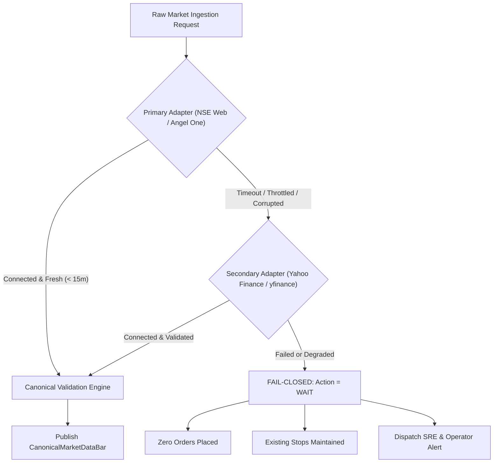
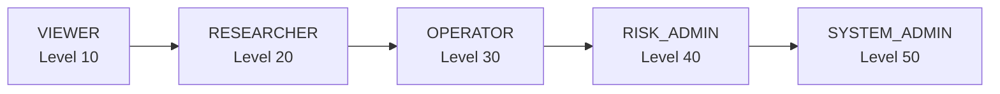
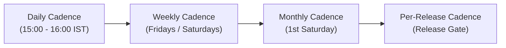

# Algo Lab Operational Handover & Standard Operating Procedures (SOP)

## Document Control & Governance Metadata

| Attribute | Canonical Value |
|---|---|
| **Document ID** | `RUNBOOK-OPS-001` |
| **Title** | Standard Operating Procedures & Operational Handover Manual |
| **Document Version** | `1.0.0` |
| **Target Platform Release** | `0.3.0` |
| **Lifecycle State** | `forward-paper-validation` |
| **Execution Policy** | `Strict Paper-Only` (Permanent Invariant) |
| **Authority** | Lead Systems Architect, Operations & Governance Lead |
| **Classification** | Institutional Production Operations & Handover Manual |
| **Review Cadence** | Monthly / Per-Release Mandatory |
| **Effective Date** | 2026-10-14 |

---

## 1. Executive Summary & Purpose

This document constitutes the formal **Operational Handover and Procedures Manual** for the Algo Lab quantitative research and autonomous forward paper-simulation operating system. 

The objective of this runbook is to provide operations teams, Site Reliability Engineers (SREs), risk officers, and quantitative developers with deterministic, battle-tested, and step-by-step procedures to maintain 24/7 autonomous forward simulation, respond to anomalous market conditions, enforce non-negotiable safety boundaries, and conduct routine platform maintenance without risk of unverified state drift or downtime.

### Core Operational Principles
1. **Fail-Closed by Design**: If system state, data freshness, market connectivity, or execution parameters are ambiguous, the platform immediately defaults to cash (`WAIT` / `HOLD`).
2. **Permanent Paper-Only Invariant**: Production real broker execution is strictly prohibited (`LIVE_TRADING_ENABLED = False`, `REAL_BROKER_EXECUTION_ENABLED = False`). Any drift toward live capital routing constitutes an immediate P0 compliance violation.
3. **Double-Entry State Verification**: The SQLite double-entry transactional ledger (`data/swing_portfolio_ledger.db`) is the canonical source of truth for portfolio cash and positions. The runtime JSON state (`data/live_portfolio_state.json`) acts as an atomic cache and must strictly reconcile with the SQLite ledger.
4. **Zero-Trust Security & Auditability**: Every privileged action, key rotation, and order submission is cryptographically authenticated, rate-limited, and logged in immutable JSON structured audit trails.

---

## 2. Circuit-Breaker Recovery Procedure

### 2.1 Trigger Conditions & Severity
The Algo Lab global portfolio risk engine automatically trips the circuit breaker (`algolab_circuit_breaker_active == 1`) under any of the following conditions:
- **Daily Drawdown Breach**: Portfolio loss exceeds the configured daily risk envelope (default: 5.0% of peak equity).
- **Rapid Adverse Stop-Outs**: Multiple consecutive stop losses hit within a single trading session.
- **Exchange Volatility Halts**: NIFTY 50 or constituent tickers trigger official NSE lower/upper circuit bands.
- **State Inconsistency**: Reconciliation break between the SQLite ledger and runtime state cache.

**Incident Severity**: **P0 (Critical)**. All new order generation is immediately blocked; active positions enter defensive monitoring mode.

---

### 2.2 Step 1: Root-Cause Identification & Isolation

1. **Check Live Circuit Breaker Status in Runtime State**:
   ```bash
   cat /home/ubuntu/algolab/data/live_portfolio_state.json | jq '{
     circuit_breaker_active: .circuit_breaker_active,
     circuit_breaker: .circuit_breaker,
     drawdown_pct: .current_drawdown_pct,
     daily_loss: .daily_loss,
     realized_pnl: .realized_pnl,
     unrealized_pnl: .unrealized_pnl
   }'
   ```

2. **Inspect Risk Engine Audit Logs**:
   ```bash
   tail -n 100 /home/ubuntu/algolab/logs/risk_engine.log | grep -E "CIRCUIT_BREAKER|DRAWDOWN|LIMIT_BREACH"
   ```

3. **Verify Prometheus Metric Flag**:
   ```bash
   curl -s http://127.0.0.1:8000/metrics | grep algolab_circuit_breaker_active
   # If active, returns: algolab_circuit_breaker_active 1
   ```

4. **Classify Root Cause**:
   - *Class A (Market Drawdown)*: Real portfolio loss caused by adverse price movement.
   - *Class B (Data Feed Spike / Bad Tick)*: An erroneous price quote or aberrant candle triggered an artificial drawdown calculation.
   - *Class C (State Desynchronization)*: Mismatch between internal database and state cache.

---

### 2.3 Step 2: Manual Reconciliation Between SQLite Ledger & JSON State

The platform maintains two state stores:
- **Canonical Ground Truth**: `data/swing_portfolio_ledger.db` (ACID SQLite double-entry ledger).
- **Point-in-Time Cache**: `data/live_portfolio_state.json` (Atomic JSON cache).

To reconcile both stores manually:

1. **Inspect Open Positions in Canonical SQLite Ledger**:
   ```bash
   python3 -c "
   import sqlite3
   conn = sqlite3.connect('/home/ubuntu/algolab/data/swing_portfolio_ledger.db')
   conn.row_factory = sqlite3.Row
   positions = conn.execute('SELECT symbol, quantity, entry_price, current_price, status, allocated_capital, stop_loss FROM positions WHERE status=\"OPEN\"').fetchall()
   print(f'=== SQLITE OPEN POSITIONS ({len(positions)}) ===')
   for p in positions:
       print(dict(p))
   "
   ```

2. **Inspect Cash Ledger Balance**:
   ```bash
   python3 -c "
   import sqlite3
   conn = sqlite3.connect('/home/ubuntu/algolab/data/swing_portfolio_ledger.db')
   cur = conn.cursor()
   balance = cur.execute('SELECT SUM(credit) - SUM(debit) FROM cash_ledger').fetchone()[0] or 0.0
   print(f'=== SQLITE NET CASH BALANCE: ₹{balance:,.2f} ===')
   "
   ```

3. **Compare Against JSON State File**:
   ```bash
   python3 -c "
   import json
   with open('/home/ubuntu/algolab/data/live_portfolio_state.json', 'r') as f:
       data = json.load(f)
   print('=== JSON CACHE STATE ===')
   print(f'Cash: ₹{data.get(\"cash\"):,.2f}')
   print(f'Equity: ₹{data.get(\"equity\"):,.2f}')
   print(f'Open Positions Count: {len(data.get(\"positions\", {}))}')
   for sym, pos in data.get('positions', {}).items():
       print(f'  {sym}: Qty {pos.get(\"quantity\")} @ Avg {pos.get(\"entry_price\")} (Current: {pos.get(\"current_price\")})')
   "
   ```

4. **Execute Deterministic Ledger Re-synchronization (If Mismatched)**:
   If the JSON state cache became corrupted or out-of-sync due to an ungraceful crash:
   ```bash
   python3 -c "
   import json, sqlite3, sys
   from pathlib import Path

   db_path = Path('/home/ubuntu/algolab/data/swing_portfolio_ledger.db')
   json_path = Path('/home/ubuntu/algolab/data/live_portfolio_state.json')

   conn = sqlite3.connect(db_path)
   conn.row_factory = sqlite3.Row
   cur = conn.cursor()

   # Retrieve latest portfolio snapshot
   snapshot = cur.execute('SELECT * FROM portfolio_snapshots ORDER BY timestamp DESC LIMIT 1').fetchone()
   positions = cur.execute('SELECT * FROM positions WHERE status=\"OPEN\"').fetchall()

   pos_dict = {}
   pos_val = 0.0
   for p in positions:
       val = p['quantity'] * p['current_price']
       pos_val += val
       pos_dict[p['symbol']] = {
           'symbol': p['symbol'],
           'quantity': p['quantity'],
           'entry_price': p['entry_price'],
           'current_price': p['current_price'],
           'allocated_capital': p['allocated_capital'],
           'stop_loss': p['stop_loss'],
           'target_price': p['target_price'],
           'status': 'OPEN'
       }

   cash = snapshot['cash'] if snapshot else 100000.0
   equity = round(cash + pos_val, 2)

   reconciled_state = {
       'account_id': 'STAGE31_ACCOUNT_001',
       'session_id': 'STAGE31_FORWARD_PAPER_20260928_001',
       'schema_version': '0.3.0',
       'cash': cash,
       'equity': equity,
       'peak_capital': max(equity, snapshot['peak_capital'] if snapshot else 100000.0),
       'net_pnl': snapshot['net_pnl'] if snapshot else 0.0,
       'realized_pnl': snapshot['realized_pnl'] if snapshot else 0.0,
       'unrealized_pnl': round(pos_val - sum(p['allocated_capital'] for p in positions), 2),
       'positions': pos_dict,
       'open_orders': [],
       'circuit_breaker_active': True,
       'circuit_breaker': {'active': True, 'reason': 'PENDING_ADMIN_UNLATCH', 'timestamp': 'RECONCILED'}
   }

   tmp = json_path.with_suffix('.tmp')
   with open(tmp, 'w') as f:
       json.dump(reconciled_state, f, indent=2)
   tmp.replace(json_path)
   print('✅ Reconciled JSON cache successfully regenerated from SQLite ground truth.')
   "
   ```

---

### 2.4 Step 3: Safety Verification

Prior to unlatching the circuit breaker, verify system invariants:

1. **Execute Canonical Safety Invariant Suite**:
   ```bash
   cd /home/ubuntu/algolab
   make safety-check
   ```
   *Expected Output:*
   ```text
   ==> [1/7] Auditing Non-Negotiable Safety Invariants...
   ✅ ALL SAFETY INVARIANTS CERTIFIED: 100% PAPER-ONLY COMPLIANCE.
   ```

2. **Verify Point-in-Time Market Prices**:
   Confirm that current marks in the database reflect authentic exchange prices and not anomalous outlier ticks:
   ```bash
   .venv/bin/python3 scripts/bounded_market_data_smoke_test.py
   ```

3. **Verify No Pending / Stale Orders**:
   ```bash
   python3 -c "
   import sqlite3
   conn = sqlite3.connect('data/swing_portfolio_ledger.db')
   open_orders = conn.execute('SELECT COUNT(*) FROM order_ledger WHERE status IN (\"PENDING\", \"SUBMITTED\", \"PARTIALLY_FILLED\")').fetchone()[0]
   print(f'Pending Orders in Ledger: {open_orders}')
   assert open_orders == 0, 'Must have 0 pending orders before unlatching'
   "
   ```

---

### 2.5 Step 4: Controlled Unlatching

> [!IMPORTANT]
> Unlatching the circuit breaker requires formal documented sign-off from the **Risk Administrator (`risk_admin`)** or **Chief Risk Officer (CRO)**. Do not unlatch during active market hours if the daily drawdown limit was legitimately breached.

1. **Controlled Unlatch Execution**:
   ```bash
   python3 -c "
   import json
   state_file = 'data/live_portfolio_state.json'
   with open(state_file, 'r') as f:
       state = json.load(f)
   state['circuit_breaker_active'] = False
   state['circuit_breaker'] = {
       'active': False,
       'reason': 'CLEARED_POST_RECONCILIATION_SIGN_OFF',
       'cleared_by': 'risk_admin',
       'timestamp': '2026-10-14T00:00:00Z'
   }
   with open(state_file, '.tmp') as f:
       json.dump(state, f, indent=2)
   import os
   os.replace(state_file + '.tmp', state_file)
   print('✅ Circuit breaker unlatch committed to state file.')
   "
   ```

2. **Restart Autonomous Paper Daemon**:
   ```bash
   sudo systemctl restart quant-os.service
   ```

3. **Verify Observability Metric Status**:
   ```bash
   sleep 2
   curl -s http://127.0.0.1:8000/metrics | grep algolab_circuit_breaker_active
   # Must return: algolab_circuit_breaker_active 0
   ```

4. **Verify Daemon Heartbeat**:
   ```bash
   journalctl -u quant-os.service -n 20 --no-pager
   ```

---

## 3. Credential Rotation Procedure

### 3.1 Architecture: Hashing at Rest & Constant-Time Verification
Algo Lab enforces institutional credential security via [`apps/api/core/rbac.py`](file:///home/ubuntu/algolab/apps/api/core/rbac.py) and [`apps/api/core/security.py`](file:///home/ubuntu/algolab/apps/api/core/security.py):
- **Raw Keys Never Persisted**: Raw API secrets are never stored in memory tables or databases.
- **Cryptographic Digest**: All credentials are saved as SHA-256 digests (`hash_key()`).
- **Timing Attack Resistance**: Key authentication employs constant-time digest comparison (`hmac.compare_digest`).
- **Granular Scoping**: Keys possess assigned roles (`viewer`, `researcher`, `operator`, `risk_admin`, `system_admin`) and strict permission scopes.

---

### 3.2 Standard Zero-Downtime API Key Rotation
To rotate an internal or system actor API key without interrupting running daemons or services:

#### Step 1: Generate High-Entropy Replacement Secret
```bash
NEW_SECRET=$(openssl rand -hex 32)
echo "Generated New Secret (store securely in vault): ${NEW_SECRET}"
```

#### Step 2: Register New Key in ApiKeyRegistry
Use the interactive Python management runtime or internal management script:
```bash
python3 -c "
from apps.api.core.rbac import key_registry, Role
meta = key_registry.register_key(
    raw_key='${NEW_SECRET}',
    key_id='operator-key-v2',
    role=Role.OPERATOR,
    scopes=['read:research', 'write:experiments', 'operate:paper'],
    description='Rotated operator credential Q4-2026'
)
print(f'Registered key {meta.key_id} with hash: {meta.hashed_key[:16]}...')
"
```

#### Step 3: Update Client Callers / Services
Update the client application, background task, or webhook sender to use `${NEW_SECRET}`. Both the old key and new key will authenticate successfully during this overlapping grace window.

#### Step 4: Verify Authentication with New Key
```bash
curl -iv -H "X-API-Key: ${NEW_SECRET}" http://127.0.0.1:8000/api/v1/system/info
# Must return HTTP 200 OK
```

#### Step 5: Revoke Deprecated Key
```bash
python3 -c "
from apps.api.core.rbac import key_registry
revoked = key_registry.revoke_key('operator-key-v1')
print(f'Old key revoked: {revoked}')
"
```

#### Step 6: Verify Deprecated Key Fails Closed
```bash
curl -iv -H "X-API-Key: OLD_DEPRECATED_SECRET" http://127.0.0.1:8000/api/v1/paper-trading/sessions
# Must return HTTP 401 UNAUTHORIZED or 403 FORBIDDEN
```

---

### 3.3 Zero-Downtime Master Internal Secret (`INTERNAL_API_SECRET`) Rotation
To rotate the platform-wide master internal secret:

1. **Stage New Secret in `.env`**:
   ```bash
   NEW_MASTER_SECRET=$(openssl rand -hex 32)
   # Backup existing .env
   cp /home/ubuntu/algolab/.env /home/ubuntu/algolab/.env.bak_$(date +%Y%m%d)
   sed -i "s/INTERNAL_API_SECRET=.*/INTERNAL_API_SECRET=${NEW_MASTER_SECRET}/g" /home/ubuntu/algolab/.env
   ```

2. **Reload API Service Container (Zero Downtime)**:
   ```bash
   cd /home/ubuntu/algolab
   docker compose up -d --no-deps api
   ```

3. **Validate Liveness & Readiness**:
   ```bash
   curl -s http://127.0.0.1:8000/health | jq .
   curl -s -H "X-Internal-Secret: ${NEW_MASTER_SECRET}" http://127.0.0.1:8000/api/v1/system/info | jq .
   ```

---

### 3.4 Emergency Revocation of Compromised Credentials
If a key is accidentally committed to source control, leaked in logs, or exposed to an untrusted actor:

1. **Immediate Revocation via Python One-Liner**:
   ```bash
   python3 -c "
   from apps.api.core.rbac import key_registry
   target_key_id = 'compromised-key-id'
   if key_registry.revoke_key(target_key_id):
       print(f'🚨 Key {target_key_id} IMMEDIATELY REVOKED.')
   else:
       print('Key ID not found in registry.')
   "
   ```

2. **Audit Breach Activity via Structured Security Logs**:
   ```bash
   grep -i "compromised-key-id" /home/ubuntu/algolab/logs/api_access.log | jq '{
     timestamp: .timestamp,
     endpoint: .endpoint,
     method: .method,
     status: .status_code,
     ip: .client_ip
   }'
   ```

3. **Check Prometheus Authorization Failure Metrics**:
   ```bash
   curl -s http://127.0.0.1:8000/metrics | grep algolab_http_auth_failures_total
   ```

---

## 4. Data-Provider Outage & Failover Procedure

### 4.1 Degraded Feed Detection & Thresholds
Algo Lab continuously monitors market data ingestion quality across 11 mathematical dimensions:
- **Alert Rule**: `DataStalenessSpike` (`increase(algolab_stale_data_rejections_total[5m]) > 10`).
- **Heartbeat Alert**: `DaemonHeartbeatLost` (No heartbeat for > 300s during 09:15-15:30 IST).
- **Price Anomaly**: Negative price, zero volume on liquid constituent, or High < Low.

---

### 4.2 Adapter Hierarchy & Supported Feeds



| Feed Tier | Adapter Name | Implementation | Characteristics |
|---|---|---|---|
| **Primary Live** | `NSE_INDIA` | [`NSELiveMarketDataAdapter`](file:///home/ubuntu/algolab/services/market-data/adapters/nse_adapter.py) | Direct official NSE web quote and Bhavcopy ingestion via `jugaad-data`. Zero latency. |
| **Primary Broker** | `ANGEL_ONE` | [`AngelOneMarketDataAdapter`](file:///home/ubuntu/algolab/services/market-data/adapters/angel_one.py) | WebSocket / REST SmartAPI quote streaming (observation only). |
| **Secondary Fallback** | `YFINANCE` | [`YFinanceMarketDataAdapter`](file:///home/ubuntu/algolab/services/market-data/adapters/yfinance_adapter.py) | Delayed / EOD Yahoo Finance historical quotes (`.NS` ticker normalization). |
| **Offline Replay** | `FILE_REPLAY` | [`services/market-data/storage.py`](file:///home/ubuntu/algolab/services/market-data/storage.py) | Point-in-time validated Parquet historical bars with SHA-256 digests. |

---

### 4.3 Switching Between Primary and Fallback Adapters

1. **Test Primary Feed Connectivity**:
   ```bash
   python3 -c "
   from services.market_data.adapters.nse_adapter import NSELiveMarketDataAdapter
   adapter = NSELiveMarketDataAdapter()
   print(adapter.test_connection())
   "
   ```

2. **If Primary Feed Fails, Test Fallback (Yahoo Finance)**:
   ```bash
   python3 -c "
   from services.market_data.adapters.yfinance_adapter import YFinanceMarketDataAdapter
   adapter = YFinanceMarketDataAdapter()
   print(adapter.test_connection())
   bar = adapter.get_latest_bar('RELIANCE')
   print('Latest bar:', bar)
   "
   ```

3. **Verify Autonomous Multi-Provider Smoke Test**:
   ```bash
   python3 scripts/bounded_market_data_smoke_test.py
   ```

4. **Force Strategy Daemon to Secondary Fallback (If Primary Hard Down)**:
   In `quant-os.service` or runtime environment:
   ```bash
   # Set adapter override
   sudo systemctl stop quant-os.service
   # Verify environment configuration in quant-os.service:
   # Environment="MARKET_DATA_PROVIDER=YFINANCE"
   sudo systemctl start quant-os.service
   ```

---

### 4.4 Strict Enforcement of `WAIT` Action When Feeds Fail
In accordance with **Principle 3 (Bad or uncertain data must not produce a trading decision)** and **Principle 13 (Data validation must fail closed)**:

1. **Synthetic Data Prohibition**:
   Under no circumstances may synthetic, interpolated, or simulated data be injected into forward paper execution pipelines.
2. **Deterministic `WAIT` Default**:
   If candlestick bars fail validation (`is_valid == False`) or timestamps are stale:
   - Candidate trade generator returns `action: "WAIT"`.
   - Capital reservation requests are rejected.
   - Stop-loss engines retain previous high-water mark without ratcheting on unverified ticks.
3. **Operator Notification**:
   The notification engine immediately dispatches a high-priority warning to Discord / Telegram:
   ```text
   ⚠️ [ALGO LAB ALERT] Market Data Feed Severed — Enforcing WAIT State
   Timestamp: 2026-10-14 15:10:00 IST
   Action: All trade decisions suspended. Open positions held safely.
   ```

---

## 5. Paper-Engine Emergency Halt & Quarantine Protocol

### 5.1 Emergency Halt Triggers
Execute the Emergency Halt sequence immediately upon detection of:
- Any attempt to enable live broker execution (`algolab_live_trading_enabled == 1`).
- Runaway order creation or looping process in `live_market_daemon.py`.
- Critical database corruption or unhandled runtime deadlock.
- Host-level security breach or unauthenticated control mutation.

---

### 5.2 Step-by-Step Emergency Halt Sequence

```bash
# ==============================================================================
# 1. SEND SIGTERM FOR GRACEFUL STATE PERSISTENCE (OR SIGKILL IF HUNG)
# ==============================================================================
sudo systemctl stop quant-os.service

# If daemon does not terminate within 5 seconds, send immediate SIGKILL:
if pgrep -f "live_market_daemon.py" > /dev/null; then
    echo "⚠️ Daemon did not exit on SIGTERM; executing hard SIGKILL..."
    sudo pkill -9 -f "live_market_daemon.py"
fi

# Verify process is completely terminated:
pgrep -f "live_market_daemon.py" && echo "❌ Process still alive!" || echo "✅ Daemon killed successfully."

# ==============================================================================
# 2. HALT INGRESS PROXY & API SERVERS
# ==============================================================================
cd /home/ubuntu/algolab
docker compose stop api proxy

# ==============================================================================
# 3. VERIFY LOOPBACK PORTS ARE CLOSED
# ==============================================================================
nc -z 127.0.0.1 8000 && echo "❌ API Port 8000 still open!" || echo "✅ Port 8000 closed."
```

---

### 5.3 Forensic Quarantine & State Snapshotting

Do NOT wipe or overwrite any state directories. Immediately preserve a timestamped forensic copy:

```bash
FORENSIC_DIR="/home/ubuntu/incident_forensics_$(date +%Y%m%d_%H%M%S)"
mkdir -p "${FORENSIC_DIR}"

echo "Creating forensic preservation in ${FORENSIC_DIR}..."

# 1. Snapshot databases, JSON state, and manifests
cp -r /home/ubuntu/algolab/data "${FORENSIC_DIR}/data_snapshot"

# 2. Snapshot system and engine logs
cp -r /home/ubuntu/algolab/logs "${FORENSIC_DIR}/logs_snapshot"

# 3. Snapshot runtime lockfiles and process tables
ls -la /tmp/algolab* > "${FORENSIC_DIR}/tmp_locks.txt" 2>&1 || true
ps aux > "${FORENSIC_DIR}/process_table.txt"

# 4. Snapshot git repository state and recent diffs
cd /home/ubuntu/algolab
git status > "${FORENSIC_DIR}/git_status.txt"
git diff > "${FORENSIC_DIR}/git_diff.txt"
git log -n 10 --stat > "${FORENSIC_DIR}/git_log.txt"

# 5. Compute cryptographic SHA-256 checksums of all forensic artifacts
find "${FORENSIC_DIR}" -type f -exec sha256sum {} + > "${FORENSIC_DIR}/FORENSIC_MANIFEST.sha256"

echo "✅ Forensic state quarantined and cryptographically sealed at ${FORENSIC_DIR}."
```

---

### 5.4 Transaction Rollback & State Compensation
If invalid paper trades were booked during the anomaly:

1. **Do NOT Silently Delete Ledger Rows**: In accordance with institutional double-entry bookkeeping standards, physical rows in `swing_portfolio_ledger.db` must never be deleted without an audit trail.
2. **Issue Compensating Adjustment Entries**:
   ```bash
   python3 -c "
   import sqlite3
   from datetime import datetime, timezone

   conn = sqlite3.connect('data/swing_portfolio_ledger.db')
   cur = conn.cursor()

   # Example: Reversing an erroneous paper position
   erroneous_symbol = 'BADTICK_SYM'
   pos = cur.execute('SELECT * FROM positions WHERE symbol=? AND status=\"OPEN\"', (erroneous_symbol,)).fetchone()
   if pos:
       print(f'Rolling back open position for {erroneous_symbol}...')
       # Close position with COMPENSATING_CANCEL status
       cur.execute('UPDATE positions SET status=\"COMPENSATING_CANCEL\" WHERE symbol=?', (erroneous_symbol,))
       # Refund debited capital to cash ledger
       refund_amount = pos[5]  # allocated_capital
       cur.execute('''
           INSERT INTO cash_ledger (timestamp, entry_type, debit, credit, description, account_id)
           VALUES (?, \"ADJUSTMENT\", 0.0, ?, ?, \"STAGE31_ACCOUNT_001\")
       ''', (datetime.now(timezone.utc).isoformat(), refund_amount, f'Compensating reversal for {erroneous_symbol}'))
       conn.commit()
       print('✅ Reversal adjustment booked successfully.')
   "
   ```

3. **Re-generate Clean `live_portfolio_state.json`** using Step 2.3.

---

## 6. Deployment Rollback Procedure

### 6.1 Rollback Trigger Criteria
A deployment rollback must be executed if any of the following occur post-deployment:
- Canonical release gate (`make release-check`) fails on production/staging host.
- API container fails health checks (`/health` probe returns 500 or timeout).
- Schema migration error between database and running services.
- Recovery Time Objective (RTO) target: **< 5 minutes**.

---

### 6.2 Step 1: Docker Compose Fast Rollback

```bash
cd /home/ubuntu/algolab

# 1. Stop current containers
docker compose down

# 2. Revert Git codebase to last known stable tag / commit
git log --oneline -n 5
# Check out certified release tag or previous commit:
git checkout HEAD~1

# 3. Verify Safety Invariants on reverted code
make safety-check

# 4. Rebuild and launch hardened containers
docker compose up -d --build

# 5. Verify container health
docker compose ps
curl -s http://127.0.0.1:8000/health | jq .
```

---

### 6.3 Step 2: Point-in-Time Backup Restoration (RTO < 5 Minutes)

Algo Lab includes automated encrypted backup and restore tooling in [`scripts/backup_restore.py`](file:///home/ubuntu/algolab/scripts/backup_restore.py):

1. **Identify Most Recent Certified Encrypted Backup**:
   ```bash
   LATEST_BACKUP=$(ls -t /home/ubuntu/algolab/backups/*.tar.enc | head -n 1)
   echo "Selected Backup Archive: ${LATEST_BACKUP}"
   ```

2. **Verify Backup Integrity & Manifest Checksums**:
   ```bash
   python3 /home/ubuntu/algolab/scripts/backup_restore.py --verify "${LATEST_BACKUP}"
   ```
   *Expected Output:*
   ```text
   ✅ Archive SHA-256 digest verified.
   ✅ All inner files verified against cryptographic manifest.
   ```

3. **Restore Database & State Artifacts**:
   ```bash
   python3 /home/ubuntu/algolab/scripts/backup_restore.py --restore "${LATEST_BACKUP}" --target-dir /home/ubuntu/algolab/data/
   ```
   *Restoration takes < 5 seconds, well below the 5-minute RTO SLA.*

4. **Verify Database Integrity via SQLite Engine**:
   ```bash
   python3 -c "
   import sqlite3
   conn = sqlite3.connect('/home/ubuntu/algolab/data/swing_portfolio_ledger.db')
   integrity = conn.execute('PRAGMA integrity_check').fetchall()
   fk = conn.execute('PRAGMA foreign_key_check').fetchall()
   print('Integrity Check:', integrity)
   print('Foreign Key Check:', fk)
   assert integrity == [('ok',)], 'Database failed integrity check!'
   assert len(fk) == 0, 'Foreign key violations found!'
   print('✅ SQLite Database integrity certified.')
   "
   ```

5. **Run Disaster Recovery Automated Smoke Test**:
   ```bash
   python3 /home/ubuntu/algolab/scripts/backup_restore.py --test-restore
   ```

---

## 7. Role & Permission Matrix (RBAC)

Algo Lab enforces a formal 5-tier role hierarchy defined in [`apps/api/core/rbac.py`](file:///home/ubuntu/algolab/apps/api/core/rbac.py):

$$\text{VIEWER (10)} \subset \text{RESEARCHER (20)} \subset \text{OPERATOR (30)} \subset \text{RISK\_ADMIN (40)} \subset \text{SYSTEM\_ADMIN (50)}$$



### 7.1 Role Definitions & Capabilities

| Role Name | Hierarchy Level | Primary Persona | Platform Capabilities & Boundaries |
|---|---|---|---|
| `viewer` | **10** | External Auditor, Read-Only Observer | Can view dashboards, metrics, system principles, and health probes. Cannot submit experiments or alter any state. |
| `researcher` | **20** | Quantitative Analyst, Strategy Developer | All `viewer` capabilities + define, validate, submit backtests/experiments, compare results, inspect datasets, run historical replays. |
| `operator` | **30** | Trading Operations Engineer, SRE | All `researcher` capabilities + create, start, pause, and stop paper sessions, submit paper orders, inspect private broker connections, restart daemons. |
| `risk_admin` | **40** | Risk Manager, Chief Risk Officer | All `operator` capabilities + unlatch circuit breakers, adjust risk limits, quarantine corrupted datasets, resolve uncertain orders, approve reconciliation breaks. |
| `system_admin` | **50** | Platform Architect, SecOps Lead | Full unconditional administrative control (`*` scope): API key issuance/rotation/revocation, DR backup restore, infrastructure modification, environment configuration. |

---

### 7.2 Granular Endpoint & Capability Authorization Matrix

| Endpoint Path | HTTP Method | Minimum Required Role | Required Scope | Capability Description |
|---|---|---|---|---|
| `/` | `GET` | *Public / None* | None | Platform identity, canonical version (`0.3.0`), invariants |
| `/health` | `GET` | *Public / None* | `read:health` | Liveness health probe for load balancers / probes |
| `/health/ready` | `GET` | *Public / None* | `read:health` | Readiness health probe verifying database / cache |
| `/metrics` | `GET` | *Public / None* | `read:health` | Prometheus text-format observability scrape metrics |
| `/api/dashboard/portfolio` | `GET` | `viewer` | `read:research` | Current portfolio equity, cash, and P&L status |
| `/api/dashboard/positions` | `GET` | `viewer` | `read:research` | Active swing positions and stop-loss marks |
| `/api/dashboard/system-status` | `GET` | `viewer` | `read:research` | Daemon uptime, calendar status, invariant check |
| `/api/v1/system/info` | `GET` | `viewer` | `read:system` | Detailed system status, memory, and safety locks |
| `/api/v1/system/principles` | `GET` | `viewer` | `read:system` | 25 non-negotiable quantitative research principles |
| `/api/v1/system/market-feed/status` | `GET` | `viewer` | `read:system` | Real-time market data feed health & provenance |
| `/api/v1/data/session/status` | `GET` | `viewer` | `read:research` | Official NSE session schedule (open/closed/holiday) |
| `/api/v1/data/instruments` | `GET` | `viewer` | `read:research` | Constituents list (Nifty 50 tickers & sectors) |
| `/api/v1/data/validate` | `POST` | `researcher` | `read:data` | Validate bar series across 11 quality dimensions |
| `/api/v1/datasets` | `GET` | `viewer` | `read:research` | List registered historical datasets and manifests |
| `/api/v1/datasets/register` | `POST` | `researcher` | `write:experiments` | Register a new historical dataset with SHA-256 hash |
| `/api/v1/datasets/{id}` | `GET` | `viewer` | `read:research` | Inspect dataset metadata and cryptographic provenance |
| `/api/v1/datasets/{id}/verify` | `POST` | `researcher` | `read:data` | Verify dataset integrity against disk corruption |
| `/api/v1/datasets/{id}/quarantine` | `POST` | `risk_admin` | `risk:limits` | Quarantine corrupted/unverified dataset |
| `/api/v1/experiments` | `GET` | `viewer` | `read:research` | List historical backtest experiment definitions |
| `/api/v1/experiments` | `POST` | `researcher` | `write:experiments` | Create new quantitative backtest experiment |
| `/api/v1/experiments/validate` | `POST` | `researcher` | `write:experiments` | Dry-run configuration validation for experiments |
| `/api/v1/experiments/{id}` | `GET` | `viewer` | `read:research` | Retrieve experiment parameters and code hash |
| `/api/v1/experiments/{id}/submit` | `POST` | `researcher` | `write:experiments` | Submit experiment to execution queue |
| `/api/v1/experiments/{id}/runs/{rid}` | `GET` | `viewer` | `read:research` | Get run progress and intermediate metrics |
| `/api/v1/experiments/{id}/runs/{rid}/results` | `GET` | `viewer` | `read:research` | Retrieve Sharpe, Max Drawdown, CAGR, and trade logs |
| `/api/v1/experiments/{id}/runs/{rid}/audit` | `GET` | `viewer` | `read:research` | Retrieve immutable execution audit trail |
| `/api/v1/experiments/compare` | `POST` | `researcher` | `read:research` | Side-by-side comparison of two experiments |
| `/api/v1/experiments/{id}/provenance` | `GET` | `viewer` | `read:research` | Full cryptographic manifest and environment snapshot |
| `/api/v1/replay/run` | `POST` | `researcher` | `write:experiments` | Execute deterministic point-in-time replay simulation |
| `/api/v1/replay/status/{id}` | `GET` | `viewer` | `read:research` | Check historical replay completion status |
| `/api/v1/paper-trading/sessions` | `GET` | `viewer` | `read:research` | List active and historical paper trading sessions |
| `/api/v1/paper-trading/sessions` | `POST` | `operator` | `operate:paper` | Create a new forward paper-trading session |
| `/api/v1/paper-trading/sessions/{id}` | `GET` | `viewer` | `read:research` | Inspect paper session portfolio and orders |
| `/api/v1/paper-trading/sessions/{id}/start` | `POST` | `operator` | `operate:paper` | Start forward paper simulation session |
| `/api/v1/paper-trading/sessions/{id}/pause` | `POST` | `operator` | `operate:paper` | Pause active paper simulation session |
| `/api/v1/paper-trading/sessions/{id}/stop` | `POST` | `operator` | `operate:paper` | Gracefully terminate paper simulation session |
| `/api/v1/paper-trading/sessions/{id}/orders` | `POST` | `operator` | `operate:paper` | Submit candidate order to paper exchange |
| `/api/v1/paper-trading/credentials` | `GET` | `operator` | `operate:paper` | Inspect private paper exchange credentials (masked) |
| `/api/v1/brokers/connections` | `GET` | `operator` | `operate:paper` | List broker connection handles (masked keys) |
| `/api/v1/brokers/connections` | `POST` | `operator` | `operate:paper` | Register new observation data adapter |
| `/api/v1/brokers/connections/{id}/test` | `POST` | `operator` | `operate:paper` | Test data feed connectivity and latency |
| `/api/v1/brokers/connections/{id}` | `DELETE` | `operator` | `operate:paper` | Remove observation adapter registration |
| **Circuit Breaker Unlatch** | `CLI/Script` | `risk_admin` | `risk:breaker` | Clear tripped circuit breaker and reset limits |
| **Uncertain Order Resolution** | `CLI/Script` | `risk_admin` | `risk:limits` | Resolve uncertain order states (`resolve_uncertain_order`) |
| **Reconciliation Break Resolution** | `CLI/Script` | `risk_admin` | `risk:limits` | Approve compensating adjustments for ledger breaks |
| **API Key Provisioning & Rotation** | `CLI/Script` | `system_admin` | `admin:keys` | Issue, rotate, or revoke API keys in registry |
| **Disaster Recovery Restore** | `CLI/Script` | `system_admin` | `*` | Decrypt and restore snapshot into production database |

---

## 8. Post-Release Operating Cadence

To maintain operational excellence, regulatory compliance, and system integrity, operating teams must adhere to the following recurring schedule:



### 8.1 Daily Operating Cadence (Market Days 09:00 - 16:00 IST)

| Time (IST) | Responsibility | Operational Task | Verification Command / Procedure |
|---|---|---|---|
| **09:00** | On-Call Operator | **Pre-Market Calendar & Feed Health Check** | Verify that today is an official NSE session and primary data adapters respond: `python3 live_market_daemon.py --once` |
| **09:15** | On-Call SRE | **Market Open Telemetry Scrape** | Verify daemon heartbeat timestamp in Prometheus: `curl -s http://127.0.0.1:8000/metrics \| grep algolab_daemon_heartbeat_timestamp` |
| **15:00 - 15:25** | Primary Operator | **Near-Close Execution Window Observation** | Monitor trailing stop loss adjustments and EOD candle ingestion: `journalctl -u quant-os.service -f` |
| **15:35** | Quantitative Ops | **Daily Paper Reconciliation** | Reconcile open positions and cash in SQLite against JSON cache: `python3 -c "import sqlite3, json; ..."` (See Section 2.3). Ensure zero discrepancies. |
| **15:40** | Data Steward | **Daily Data Quality Audit** | Run anomaly check on day's candles: `python3 -c "from services.market_data.adapters.nse_adapter import NSELiveMarketDataAdapter; ..."` |
| **15:45** | SRE / Automation | **Automated Encrypted Backup** | Trigger daily encrypted backup: `python3 scripts/backup_restore.py --create --retention-days 30` |
| **16:00** | On-Call Operator | **EOD Dispatch Verification** | Verify Discord / Telegram EOD summary was received by stakeholders. |

---

### 8.2 Weekly Operating Cadence (Fridays Post-Market / Saturdays)

| Frequency | Target Area | Protocol & Procedure | Owner |
|---|---|---|---|
| **Weekly** | **Dependency Updates & Vulnerability Triage** | Run `pip list --outdated`. Review CVE advisories. Update dependencies in virtual sandbox, re-pin versions in `requirements-pinned.txt`, and verify lock integrity via `make lock-check`. | SRE / DevOps |
| **Weekly** | **Static Security Scan & Boundary Check** | Run static application security testing: `make security-check` (Bandit) and AST boundary enforcement `pytest tests/unit/test_architecture_boundaries.py`. | SecOps |
| **Weekly** | **API Key Usage & Inactive Key Scrub** | Inspect API key registry metadata: revoke any keys expired or unused for > 30 days. Rotate operator credentials. | SecOps / Admin |
| **Weekly** | **Disk Space & Log Rotation** | Verify disk utilization on `/home/ubuntu`. Confirm `journalctl` vacuuming and archive older log files: `journalctl --vacuum-time=14d`. | SRE |

---

### 8.3 Monthly Operating Cadence (1st Saturday of Every Month)

| Frequency | Target Area | Protocol & Procedure | Owner |
|---|---|---|---|
| **Monthly** | **Disaster Recovery (DR) Drill** | Execute end-to-end sandbox restoration test: `python3 scripts/backup_restore.py --test-restore`. Measure actual RTO against < 5-minute target. | Lead SRE |
| **Monthly** | **Database Vacuum & Index Optimization** | Execute `VACUUM` and `ANALYZE` on `swing_portfolio_ledger.db` and PostgreSQL container to reclaim space and rebuild query planner indexes. | Lead Quant Developer |
| **Monthly** | **Slippage & Cost Model Recalibration** | Audit simulated fills against live NSE historical trade prints to verify that statutory tax calculations (STT, Stamp Duty, GST, Exchange fees) and slippage models match current exchange schedules. | Quantitative Lead |
| **Monthly** | **Governance & Runbook Review** | Review `OPERATIONAL_HANDOVER_AND_PROCEDURES.md` and `INCIDENT_RESPONSE_AND_ALERTS.md` to incorporate any lessons learned from monthly incident retrospectives. | Governance Lead |

---

### 8.4 Per-Release Operating Cadence (Every Version Tag / Push)

Prior to deploying any new commit or release tag to production:

```bash
# ==============================================================================
# CANONICAL RELEASE GATE — ALL 8 STAGES MUST PASS FAIL-CLOSED
# ==============================================================================
cd /home/ubuntu/algolab
make release-check

# Verification Checklist:
# 1. safety-check:    Audits LIVE_TRADING_ENABLED=False and AST boundaries
# 2. lock-check:      Verifies pinned dependency lock integrity
# 3. lint:            Flake8 syntax analysis
# 4. typecheck:       Mypy static type verification
# 5. security-check:  Bandit static security analysis
# 6. restore-check:   Automated DR backup and restore test
# 7. sbom:            Generates SPDX 2.3 JSON Software Bill of Materials
# 8. test:            Comprehensive 338-test pytest suite (80%+ coverage)
```

Additionally, run the **Deterministic Historical Replay Benchmark**:
```bash
python3 scripts/run_adaptive_market_survival_backtest.py --strategy STRATEGY_SUPER_ADAPTIVE --universe nifty50
```
Confirm that key performance metrics (CAGR, Sharpe Ratio, Max Drawdown) match certified golden baselines exactly.

---

## 9. Appendix: Emergency Contacts & War Room Runbook

| Role | Primary Contact | Secondary Contact | Escalation SLA |
|---|---|---|---|
| **Primary On-Call SRE** | PagerDuty: `algolab-sre-primary` | Telegram: `@algolab_ops_bot` | < 2 minutes (P0) |
| **Lead Quant Systems Engineer** | Slack/Telegram: `@lead-quant` | Phone: On-call roster | < 5 minutes (P0) |
| **Chief Risk Officer (CRO)** | Direct Urgent Phone Call | Encrypted Channel | Mandatory for P0 unlatching |
| **System Security Lead** | Slack: `@secops-lead` | PagerDuty: `algolab-security` | < 15 minutes |

**Emergency Incident Command**:
1. Open `#incident-war-room` channel on Slack / Telegram.
2. Designate Incident Commander (IC).
3. If live execution attempt or safety breach: **Execute Section 5 (Emergency Halt) immediately**.
4. Log all diagnostic actions and timestamps for post-mortem analysis.
